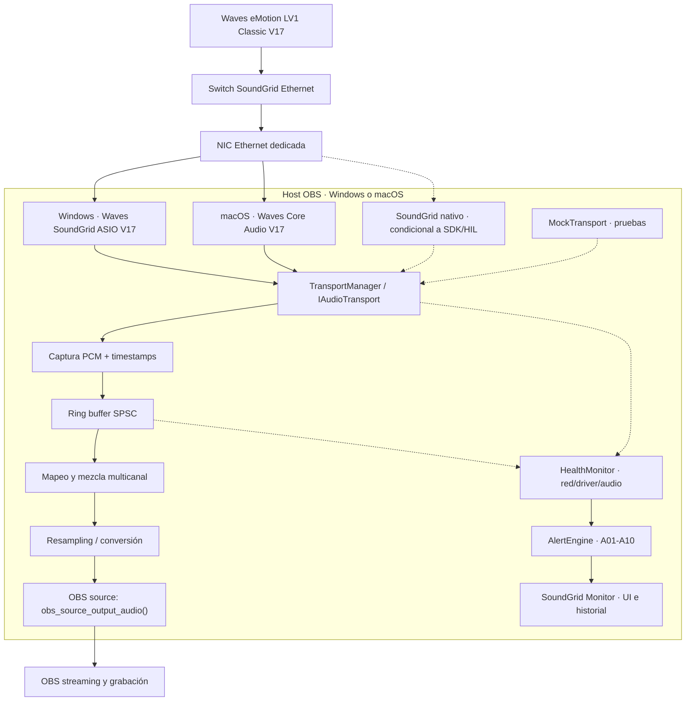
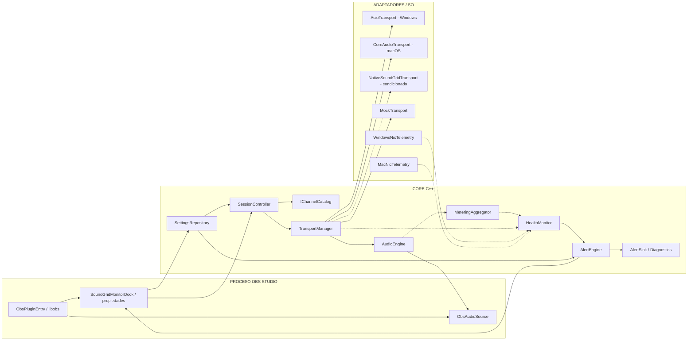
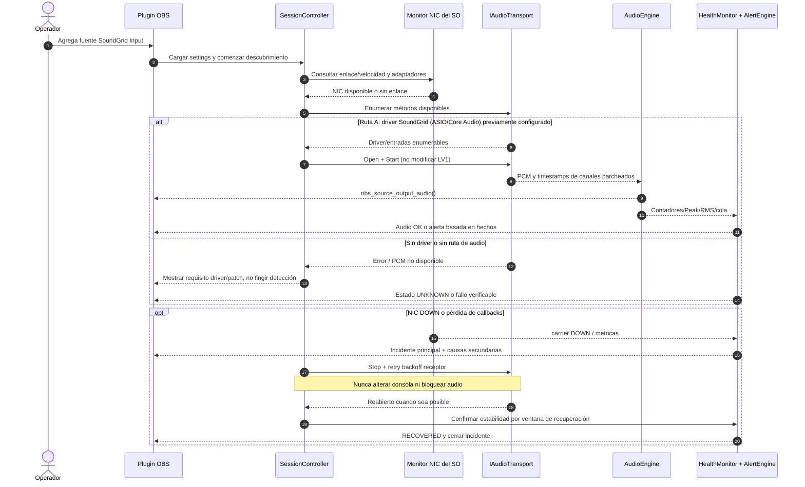
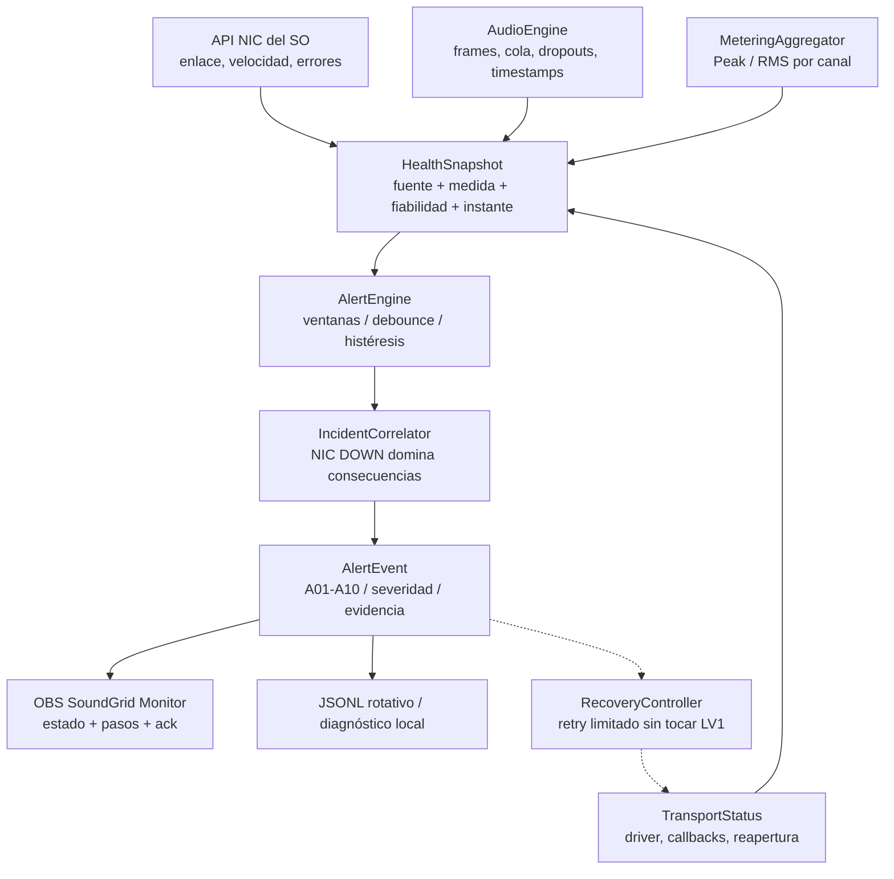

# PLAN MAESTRO PARA AGENTE DE DESARROLLO
## OBS SoundGrid Input — Waves eMotion LV1 Classic V17

**Documento de ejecución:** entregar un plugin nativo de OBS Studio para Windows y macOS que reciba audio, cuando el transporte de cada sistema lo permita, de una consola **Waves eMotion LV1 Classic V17** a través de su red Ethernet SoundGrid.

**Fecha de referencia:** 15 de noviembre de 2026.  
**Versión del plan:** 1.4 — alcance exclusivo Windows/macOS, alertas y arquitectura detallada; alineado con el SDD v2.2 (revisión del 16 de noviembre de 2026).  
**Estado:** plan actualizado para ejecución por agente; **no** es un plugin implementado ni una compatibilidad demostrada.  
**Prioridad:** continuidad y seguridad del sonido en vivo > confiabilidad del audio > automatización de la UX > funcionalidades adicionales.

---

## 0. Instrucciones obligatorias para el agente

Actúa como **arquitecto de software de audio en tiempo real, ingeniero C++/OBS, integrador de redes y responsable de QA**. Investiga los puntos desconocidos antes de asumirlos, implementa incrementos compilables, escribe pruebas automatizadas y documenta exactamente qué se ha comprobado.

**Reglas no negociables:**

1. **NO afirmar que SoundGrid es abierto ni que existe un SDK público**: es un protocolo propietario. Waves declaró disponibilidad para colaboración con desarrolladores externos, pero no presupongas que hay un SDK descargable ni permiso de distribución.
2. **NO prometer recepción SoundGrid nativa sin driver** hasta demostrar compatibilidad con documentación/licencia autorizada y pruebas en una LV1 Classic V17 real.
3. **NO confundir**: (a) detectar una interfaz Ethernet, (b) detectar un driver ASIO, (c) descubrir nodos SoundGrid, (d) obtener nombres de canales LV1, (e) obtener audio de canales correctamente parcheados. Son capacidades diferentes, con criterios de prueba diferentes.
4. **NO falsificar resultados**: las pruebas con mocks, audio generado, capturas de tráfico o un driver ASIO distinto no equivalen a pruebas con la LV1 V17. Señalar `NO PROBADO EN HARDWARE` cuando corresponda.
5. **NO modificar el show de la consola**: no cambiar reloj, ganancia, buses, rutas, mute, escena, firmware ni preamplificadores en operación. Cualquier escritura hacia LV1 requiere aprobación explícita del operador, antes de actuar.
6. **NO instalar hooks en procesos Waves, parchear binarios, extraer secretos, saltar licencias, vulnerar drivers ni depender de APIs privadas no autorizadas**. Investigar rutas oficiales y consultar términos/licencias antes de usar ingeniería inversa o información de terceros.
7. **NO bloquear el hilo de audio** con I/O de disco, asignaciones dinámicas, locks, logs, red, UI o esperas. Evitar operaciones impredecibles en callbacks de tiempo real.
8. **NO contaminar la red SoundGrid de producción** con escaneos agresivos, broadcasting de pruebas o tráfico no SoundGrid. Las pruebas exploratorias se hacen en laboratorio aislado y con autorización.
9. Crear código, pruebas, CI, empaquetado y documentación; no limitarse a recomendar bibliotecas.
10. En cada fase dejar `logs`, resultados de `ctest`, binarios compilados y un informe objetivo de estado. Si falta hardware o acceso al SDK, completar las partes posibles con simuladores y declarar el bloqueo, sin simular que está resuelto.

---

## 1. Experiencia final esperada

**Flujo UX objetivo (sin intervención manual en SoundGrid Driver Panel):**

1. Usuario instala **OBS SoundGrid Input** en Windows o macOS. El driver Waves V17 ofrece ASIO en Windows y Core Audio en macOS. El puerto Ethernet Gigabit dedicado se necesita para las rutas SoundGrid reales.
2. Conecta el PC al switch del sistema Waves eMotion LV1 Classic V17.
3. En OBS → Fuentes → **SoundGrid Input**, elige «Buscar dispositivos» o la búsqueda empieza automáticamente.
4. El plugin identifica la red SoundGrid y, **solo cuando el método de integración lo permita**, muestra la consola LV1 encontrada.
5. Muestra canales **realmente disponibles y enrutados**, con nombres reales si la API lo permite; si no, muestra entradas numeradas del driver y explica que los nombres de la consola no están disponibles.
6. Permite elegir `Main L/R`, buses o canales de entrada **únicamente cuando la consola los ha puesto a disposición** mediante patching o una API autorizada.
7. Entrega audio estable a OBS para monitoreo, grabación y streaming. Se recupera de desconexiones sin bloquear OBS.
8. Muestra un centro de **alertas operativas en tiempo real** para silencio prolongado, desconexión de audio, ausencia de red, enlace degradado y latencia elevada; permite ajustar umbrales y silenciar notificaciones sin silenciar el audio.
9. Explica el origen de cada alerta con evidencia observada (NIC, driver, buffer, nivel de señal) y distingue datos medidos de indicadores inferidos.
10. Guarda selección, mapa de canales, nivel, reconexión, umbrales de alertas y configuración del proyecto OBS.

**Diferenciar dos definiciones de éxito:**

- **MVP operativo (ruta A):** plugin de OBS con captura mediante **SoundGrid ASIO V17 (Windows)** o **SoundGrid Core Audio V17 (macOS)**, sin DAW intermedio. El usuario no necesita abrir el panel en cada sesión **si la selección previa de NIC y las asignaciones persisten**. Para la primera configuración puede requerirse panel, driver y patching LV1. Esto **NO** satisface plenamente «sin instalar/configurar SoundGrid».
- **Objetivo completo (ruta B):** plugin **sin driver/panel de Waves**, con recepción SoundGrid y descubrimiento nativos. **Condicionado** a autorización, especificación/SDK oficial o evidencia suficiente de interoperabilidad lícita, y validación en hardware. Si falta esa condición, marcar `BLOQUEADO POR PROTOCOLO`, no presentar la ruta A como cumplimiento de B.

**Importante:** incluso con un receptor nativo, que un canal exista en LV1 **no garantiza** que la consola envíe su señal a nuestra aplicación. El patching de la LV1 puede requerir una configuración en la consola. «Cero panel en PC» y «cero configuración de patch en LV1» son requisitos distintos.

---

## 2. Contexto técnico verificado y restricciones

- Waves describe SoundGrid como protocolo Audio-over-IP **propietario** y utiliza una aplicación SoundGrid host para asignar y enrutar dispositivos.
- La documentación de integración de **LV1 V17 + Tracks Live** especifica: computador aparte, SoundGrid Driver V17 o superior, NIC correcta en Control Panel, driver asignado en `Setup > Inventory` y al menos una fuente parcheada a sus entradas. La integración de nombres/colores en Tracks Live depende de requisitos adicionales (incluido MyRemote), **no implica API pública documentada**.
- La documentación del driver indica **hasta 128 canales de entrada y 128 de salida** y frecuencias **44.1, 48, 88.2 y 96 kHz** según configuración del sistema. Son capacidades del driver, **no una promesa** de que el hardware, la configuración de la sesión, el computador o OBS soporten todos esos canales simultáneamente.
- OBS admite plugins de fuentes de audio C/C++ que envían muestras mediante `obs_source_output_audio()`.
- Waves recomienda mantener la red SoundGrid separada del tráfico IP ajeno a SoundGrid; seleccionar NIC, buffers y clock exige especial cuidado en vivo.
- La **grabación directa USB de 16 canales** de LV1 Classic es otra función; el dispositivo virtual local `Recorder` **no es automáticamente una entrada de audio de red para nuestro PC**.

No dar por hecho que `SoundGrid Driver V17`, `LV1 V17`, `Tracks Live V17` o un SDK significan el mismo componente o el mismo control de acceso.

---

## 3. Plataforma y arquitectura

**Plataformas objetivo desde la primera iteración:** Windows 10/11 x64 y macOS Intel x64 / Apple Silicon arm64. OBS Studio y un switch SoundGrid dedicado. El núcleo y los mocks deben compilar en ambos sistemas desde I1; la captura real tiene gates HIL específicos. Windows usa SoundGrid ASIO V17 y macOS usa SoundGrid Core Audio V17. **No se diseñarán ni distribuirán implementaciones para otros SO.** Ver `SDD_AGILES_OBS_SOUNDGRID_WINDOWS_MACOS.md`.

**Stack:**
- C++20 (o versión compatible con plantilla oficial OBS actual) para núcleo, plugin y procesamiento.
- `libobs` + plantilla oficial `obs-plugintemplate` para el plugin, `CMake` + `Ninja`/Visual Studio para builds.
- Qt solo para propiedades/UI que requieran componentes personalizados; primero preferir `obs_properties_t`.
- GoogleTest/Catch2 o marco de pruebas C++ equivalente; `CTest`, sanitizers donde aplique, análisis estático y CI **Windows/macOS** desde el primer PR.
- ASIO SDK con licenciamiento revisado para la ruta A, o integración ASIO con dependencias auditadas. Evaluar `Andersama/obs-asio` como **referencia**, revisando licencia, mantenimiento y compatibilidad; no copiar sin cumplir licencia.
- Adaptador `NativeSoundGrid` únicamente detrás de una interfaz bien definida y marcado experimental hasta validar permiso/protocolo/hardware.

### 3.0 Matriz de compatibilidad y contratos de plataforma

| Sistema | Integración Waves oficial | Restricción principal |
|---|---|---|
| Windows 10/11 x64 | Waves SoundGrid **ASIO** V17 | Driver/configuración inicial, routing y HIL real |
| macOS Intel / Apple Silicon | Waves SoundGrid **Core Audio** V17 | Verificar compatibilidad CPU, driver y estabilidad en HIL |

Los SDD-00 a SDD-15, las iteraciones, pruebas CI y HIL están en `SDD_AGILES_OBS_SOUNDGRID_WINDOWS_MACOS.md`. El plugin y las alertas se implementarán para **Windows y macOS**. La conexión directa sin Waves Driver Panel sigue siendo un **objetivo condicionado**, no una función garantizada.

### Arquitectura lógica

```text
[Waves eMotion LV1 Classic V17]
              |
    [Switch SoundGrid]
              |
    [NIC Ethernet dedicada]
              |
    +-------------------------+
    | Windows: SoundGrid ASIO |
    | macOS: SoundGrid Audio  |
    |   Core Audio V17        |
    +-------------------------+
              |
       [IAudioTransport]
              |
      [PCM + AudioEngine]
              |
         [Plugin OBS]
              |
    [Grabación / Streaming]

  Rama alternativa (solo si se valida):
  Ethernet --> NativeSoundGridTransport --> IAudioTransport

  HealthMonitor + AlertEngine monitorizan NIC,
  transporte, PCM, buffers y latencia medible.
```

### 3.1 Diagrama detallado de despliegue y flujo de audio multiplataforma (arquitectura objetivo)

El siguiente diagrama distingue **flujo de audio** (líneas continuas), **telemetría y control** (líneas punteadas), **ruta A validable con driver Waves** y **ruta B condicionada a acceso oficial al protocolo**. La fuente LV1 solo podrá enviar audio que esté realmente disponible y parcheado. La búsqueda de dispositivos y de nombres de canales requiere capacidades comprobadas, no se infiere de detectar Ethernet.




**Aclaraciones imprescindibles:** El transporte con driver Waves V17 (**ASIO** en Windows, **Core Audio** en macOS) puede recibir PCM si la NIC, driver, inventario y patch de LV1 están correctamente configurados. `NativeSoundGridTransport` no es una implementación existente: solo se habilitará si la fase de viabilidad autoriza el desarrollo. El modo mock no demuestra conexión Waves. El plugin **no** debe cambiar patch, escenas, reloj ni ganancia de la consola automáticamente.

### 3.2 Diagrama de componentes internos y límites de responsabilidad



**Contrato de independencia:** UI, alertas, logs y consultas al sistema operativo nunca se ejecutan dentro del callback del driver (ASIO/Core Audio) ni del hilo de salida de audio. Se intercambian datos mediante contadores atómicos, colas acotadas y snapshots inmutables. Si el panel UI deja de responder, el audio debe seguir funcionando.

### 3.3 Diagrama de secuencia - conexión, captura y reanudación



La secuencia B (sin driver) **solo puede validarse y ampliarse** tras la puerta de viabilidad de la fase 4. Reconectar NIC no implica que el dispositivo Waves se haya redescubierto, se haya restablecido el patch o el audio vuelva a fluir: cada paso tiene estado separado.

### 3.4 Diagrama de monitoreo, alertas y correlación de incidentes



**Causalidad para mostrar en OBS:** `NIC DOWN` ⇒ incidente A04 principal, A02/A03 como efectos si ocurren; `NIC UP + driver ERROR` ⇒ A03; `callbacks sin frames` ⇒ A02; `frames regulares + niveles bajos` ⇒ A01 solamente si canal `ARMED`. La latencia A07 solo se muestra si existe timestamp fiable para el tramo medido, nunca derivada de un ping o de duración nominal del buffer.

### 3.5 Topología de procesos, hilos y garantías de tiempo real

| Proceso / hilo | Trabajo permitido | Trabajo prohibido | Interfaz y pruebas |
|---|---|---|---|
| Callback del driver (ASIO/Core Audio) / captura | Copiar bloques PCM, actualizar contadores atómicos, escribir a SPSC preasignada | UI, I/O, sleeps, locks disputados, allocations, red | T07, T08, T42, T48 |
| Trabajador de audio | Seleccionar canales, downmix, remuestrear cuando sea necesario, mandar audio OBS | Consultas al driver en caliente, espera por dock/alertas | T02–T08, T49 |
| Descubrimiento y sesión | Enumerar drivers/NIC, abrir y cerrar transporte, actualizar estados, retry | Modificar patches/canales LV1 sin permiso | T11–T13, T50 |
| Monitor de salud | Leer snapshots/contadores, evaluar reglas periódicamente sin sondeos agresivos | Inferir pérdidas SoundGrid no observables o bloquear callback | T25–T43, T51 |
| UI / dock OBS | Mostrar nivel, alertas, recomendaciones, persistir configuración | Leer buffers PCM de manera bloqueante o reiniciar FOH | T09, T39, T40, T52 |
| Escritor de logs | Emitir JSONL estructurado y rotativo, conservar evidencias | Escribir desde el callback de audio | T43, T53 |

**Presupuesto de seguridad:** la telemetría no debe tener prioridad sobre el audio. Las colas de eventos son acotadas, con política explícita ante saturación y contadores de eventos descartados; nunca bloquear ni crecer memoria indefinidamente. Los timestamps usan reloj monotónico para duraciones; la hora civil queda para visualizar incidentes.

### 3.6 Estados de conectividad: no fusionar estados distintos

| Estado en el panel | Fuente de evidencia | Qué demuestra | Qué NO demuestra |
|---|---|---|---|
| `NIC UP` | API de red del SO | Hay enlace Ethernet físico | Que exista consola LV1 o audio |
| `DRIVER DISCOVERED` | Enumeración ASIO / Core Audio | El driver se instala/enumera | Que esté abierto ni parcheado |
| `DRIVER RUNNING` | Callbacks válidos | Transporte de captura activo | Que haya señal audible |
| `PATCH VERIFIED` | Prueba HIL o API compatible | Ruta auditivamente identificada | Que el canal tenga señal todo el tiempo |
| `AUDIO RECEIVING` | Frames válidos y RMS/Peak | Hay audio/captura en canal elegido | Que no haya un dropout posterior |
| `LV1 IDENTIFIED` | API autorizada o identificación HIL | Se verificó identidad de consola | Que se permita configurar LV1 automáticamente |
| `LATENCY UNKNOWN` | Ausencia de timestamps fiables | No hay medida adecuada | Latencia cero o aceptable |

---

### Contratos de módulos (interfaces C++ sugeridas)

- `IAudioTransport`: `enumerateDevices()`, `getCapabilities()`, `open(config)`, `start()`, `stop()`, `close()`, `snapshot()` y callback de entrega de PCM (definición normativa: SDD §2.1).
- `IChannelCatalog`: `listAvailableChannels()` y `metadataConfidence`: `driver_port`, `verified_patch`, `lv1_named_channel`; no inventar nombres.
- `AudioEngine`: sample rate, reordenamiento, downmix, DC removal opcional, resampling cuando sea necesario, timestamps, underrun/overrun.
- `ObsAudioSource`: manejo del ciclo de vida `create`, `update`, `activate`, `deactivate`, `destroy`, salida `obs_source_output_audio()`.
- `NetworkDiscovery`: enumera NIC/estado físico; descubrimiento específico SoundGrid solo si una API/protocolo permitido lo soporta.
- `Diagnostics`: tasa de pérdidas, discontinuidades de audio, medida de latencia **solo si la instrumentación lo permite**, drift, ratio de buffers, versión, eventos de reconexión y telemetría de NIC disponible.
- `HealthMonitor`: consolida estados comprobables del sistema, empleando reloj monotónico y muestreo de bajo coste sin bloquear los callbacks de audio.
- `AlertEngine`: reglas, ventanas de observación, histéresis, severidad, deduplicación, supresión, restablecimiento y pruebas deterministas.
- `AlertSink`: expone alertas al dock de OBS, al log y a un archivo JSONL rotativo configurable; notificaciones del SO opcionales y nunca en el hilo de audio.
- `Settings`: serialización versionada, no almacenar contraseñas, safe defaults.

### Principios de concurrencia/audio

- Captura de audio en callback de driver o hilo dedicado; jamás espera por UI o red.
- Buffer circular SPSC preasignado; separar control-plane (UI, descubrimiento) de data-plane (audio).
- Manejar sincronización con fuente de reloj correcta y resampling/drift correction sin saltos audibles.
- En `obs_source_output_audio`, validar formato, frames, planos, samplerate, disposición de canales y timestamps monotónicos.
- Evitar doble procesamiento, doble resampling, feedback y clipping en downmix.
- No forzar 128 canales simultáneamente a una única salida OBS: admitir selección, stems y mezclas acotadas a layouts soportados por OBS.
- En errores: **silencio seguro y error visible**, no ruido, no datos corruptos ni cierre de OBS.

---

## 4. Fases de ejecución y puertas de calidad

### Fase 0 — Investigación técnica y prueba de viabilidad (obligatoria)

**Objetivo:** decidir qué es realizable de manera comprobable antes de implementar recepción SoundGrid sin driver.

**Tareas del agente:**
1. Releer documentación oficial Waves V17 actual, OBS API y licencias de dependencias. Guardar versiones y enlaces.
2. Identificar los componentes del sistema: LV1 Classic V17, IO SoundGrid, servidor DSP, switch, NIC receptor, sistema operativo (Windows/macOS), OBS, frecuencia de muestreo.
3. Consultar a Waves por vía oficial la disponibilidad de **SDK/API SoundGrid para software receptor**, acceso a nodos, reloj, audio y metadatos LV1, derechos de redistribución y una posible API para configurar NIC sin panel.
4. Documentar si es posible configurar el driver mediante APIs **documentadas y autorizadas**; no asumir que seleccionar la NIC es un ajuste genérico de ASIO/Core Audio.
5. Especificar qué puede detectar realmente el agente sin instalar el driver y qué depende de una API privada.
6. Montar una referencia de captura con el driver V17 (**ASIO** en Windows, **Core Audio** en macOS) con una sesión de LV1 en laboratorio (si hay hardware), usando los pasos oficiales; confirmar señales reales y correspondencia L/R.
7. Completar matriz de viabilidad y tomar decisión `RUTA A`, `RUTA B CONFIRMADA`, `RUTA B BLOQUEADA`.

**Criterios de salida:**
- Documento `docs/FEASIBILITY.md` con pruebas, restricciones, versión, fuentes y evidencia reproducible.
- Decisiones arquitectónicas ADR-001 (core único + `IAudioTransport`) y ADR-002 (ruta A/B por sistema operativo), con la numeración del SDD §7.
- Si no existe SDK/protocolo autorizado verificable, construir ruta A y dejar ruta B como investigación bloqueada. **Nunca etiquetar A como 100% sin driver**.
- Si no hay hardware, `HIL_REQUIRED` sin presentar conexión real como validada.

### Fase 1 — Repositorio, compilación y fuente de audio simulada

**Tareas:**
1. Crear repositorio desde `obsproject/obs-plugintemplate`; fijar commit/tag y versión compatible de OBS.
2. Configurar build Debug/Release x64/universal donde aplique, CMake, CTest y CI Windows y macOS.
3. Registrar una fuente `SoundGrid Input` en OBS.
4. Implementar `MockTransport` con silencio, seno a 1 kHz, ruido rosa, impulsos y hasta 32 canales lógicos para validar mapeo (configurable).
5. Entregar muestras al motor OBS; permitir seleccionar pares L/R y mezcla mono.
6. Implementar preferencias persistentes, logs y estado de fuente.

**Criterios de salida:** OBS inicia sin error; agrega fuente; muestra audio generado; grabación OBS contiene audio correcto; ningún crash al agregar/quitar/modificar fuente 100 veces; pruebas unitarias y CI verdes.

### Fase 2 — Captura real por adaptadores: ASIO Windows y Core Audio macOS (ruta A)

**Tareas:**
1. En Windows enumerar ASIO V17; en macOS enumerar Core Audio y validar SoundGrid V17 en Intel y Apple Silicon.
2. Abrir/cerrar controlador de manera segura; negociación de frecuencia, formato, buffers y canales.
3. Capturar muestras PCM con timestamps; convertir formatos sin alterar niveles.
4. Gestionar dropouts, driver ocupado, cambios de sample rate, desinstalación y reconexión.
5. Exponer entradas numeradas y mapear a fuentes OBS; no afirmar que los números corresponden automáticamente al orden/nombres de LV1.
6. Validar en banco de pruebas primero con un driver simulado u otro dispositivo ASIO/Core Audio; después con V17 y LV1 real, si está disponible.

**Criterios de salida:** captura real desde LV1 comprobada por separado en Windows HIL y macOS HIL (Intel/Apple Silicon según equipo); niveles L/R comprobados, selección y recuperación. Si no hay LV1, la prueba permanece `SIMULADO`/`PENDIENTE HIL`.

### Fase 3 — UX de descubrimiento y selección de canales

**Tareas:**
1. Detectar conexión física y estado de las NICs. Mostrar solo como `NIC detectada`; **no inferir LV1** por IP o presencia de Ethernet.
2. Reutilizar información de estado del driver Waves **si es ofrecida por API pública/soportada**.
3. Diseñar lista por niveles de certeza: `Puerto del driver #`, `Puerto parcheado verificado`, `Nombre LV1 autenticado`.
4. UI: selector de dispositivo, NIC, entrada/salida, canal(es), mapeo estéreo, medidores peak/RMS, buffer *solo cuando API lo admita*, selector de auto-reconexión, diagnóstico.
5. Guardar selección de escena OBS y recuperar fuentes sin alterar FOH.
6. Comprobar si la NIC se recuerda tras reinicio y si el panel puede permanecer cerrado. No ocultar una configuración manual necesaria.

**Criterios de salida:** interfaz funcional con resultados reales y mensajes claros de `Sin driver`, `Driver presente, NIC sin configurar`, `No hay patch`, `No hay audio`, `Conectado`, `SDK no disponible`. No fabricar consola/nombres ni declarar conexión basada solo en presencia de NIC.

### Fase 3A — Monitoreo, alertas y recuperación (obligatoria para ruta A y B)

**Objetivo:** detectar fallos de captura y red **antes de comprometer una grabación o transmisión**, mostrar información accionable y recuperar automáticamente el flujo cuando sea seguro.

**Tareas:**
1. Crear `HealthMonitor` con muestras de nivel Peak/RMS por canal y por fuente, contadores de frames, heartbeat de callback, estado del driver (ASIO/Core Audio), enlace físico de NIC, velocidad negociada, estadísticas de errores disponibles, ocupación/underruns de buffer y estado de OBS.
2. Crear `AlertEngine` con reglas A01–A10 del capítulo 4A. Distinguir **señal válida en silencio** de **captura interrumpida**; no declarar pérdida de red por silencio de una entrada.
3. Implementar un **dock o panel de estado de OBS** con estado global, alertas activas, historial, hora de inicio, métrica y umbral, posible causa y acción recomendada; incluir panel resumido en propiedades de fuente.
4. Incluir notificaciones visuales no intrusivas en OBS y eventos de log estructurados; alertas sonoras opcionales **desactivadas por defecto** para no contaminar grabación o retorno.
5. Añadir ajustes persistentes: activar/desactivar cada regla, umbral, tiempo de espera, severidad, cooldown, canal supervisado y perfil `Ensayo`, `Transmisión`, `Grabación`.
6. Implementar estados `OK`, `INFO`, `WARN`, `CRITICAL`, `UNKNOWN/NOT_SUPPORTED` y restauración `RECOVERED`; diferenciar si un valor fue `medido`, `estimado` o `no observable`.
7. Implementar recuperación del driver/conexión con backoff exponencial acotado, sin reiniciar ni reconfigurar la consola, sin alterar clock/FOH y sin loops de alerta.
8. Medir/registrar impacto en CPU/memoria y garantizar que ninguna alerta lance excepciones ni bloquee el hilo de audio.
9. Construir simuladores de cada fallo, ejecutar pruebas automatizadas T25–T43 y preparar pruebas HIL T44–T47 y T56–T57 para ventanas fuera de show.

**Criterios de salida:** cada fallo simulado produce el aviso correcto dentro de su ventana definida, sin falsos positivos en silencio intencional ni alertas duplicadas; panel y logs muestran recuperación; las métricas no disponibles se representan como `NO DISPONIBLE`, jamás con valores inventados. Si la telemetría del driver no ofrece paquetes perdidos o latencia real, medir solo lo observable y explicitar la limitación.

### Fase 4 — Integración SoundGrid nativa (ruta B, condicional)

**Puerta de entrada:** SDK autorizado / interfaz oficialmente soportada / investigación de interoperabilidad permitida con documentación suficiente, revisión legal y banco de pruebas aislado. **Si falta, no ejecutar esta fase como implementación productiva**.

**Tareas, solo si se supera la puerta:**
1. Implementar descubrimiento y ciclo de vida de nodo receptor usando APIs autorizadas.
2. Obtener reloj/sincronización, capacidades y parámetros de streams.
3. Negociar rutas/formatos sin sobreescribir la configuración activa de LV1.
4. Recibir audio real, validar paquetes/muestras, integridad, orden, jitter, reconexión.
5. Consultar canales y metadatos LV1 solo cuando API oficial lo permita; separar listado de canales de audio disponible.
6. Implementar eventuales solicitudes de patch **solo como función opcional, deshabilitada por defecto**, con permisos y confirmación del operador.
7. Probar compatibilidad exacta con LV1 Classic V17, versiones menores y cambios de red.

**Criterio de salida:** en equipo **limpio sin software/driver Waves en el PC receptor**, desde OBS se detecta dispositivo real, se capturan 2+ canales parcheados, se registra evidencia y se repite tras reinicio. Si no se puede, resultado `BLOQUEADO` con causa específica y recomendaciones a Waves.

### Fase 5 — Calidad de audio y rendimiento

**Tareas:**
1. Validar 48 kHz, 96 kHz y los demás rates **solo si la sesión/driver los soporta**; OBS preferentemente a 48 kHz.
2. Pruebas de 2, 8, 16 y 32 entradas activas; 64/128 únicamente si hardware y matriz de salida permiten probarlos, sin prometer soporte automático de mezcla OBS a ese tamaño.
3. Probar monitorización y grabación continua con enlace activo, tráfico de producción habitual permitido y distintos tamaños de buffer.
4. Medir retardo captura→OBS con señales de impulsos y referencia sincronizada. Separar latencia de driver/red, plugin, resampling y pipeline OBS.
5. Medir discontinuidades, underruns, overruns, clipping, drift, picos de CPU y memoria.
6. Ejecutar la matriz de alertas A01–A10, incluida estabilidad de umbrales, histéresis y ausencia de disparos durante una pausa musical legítima.
7. Correlacionar cada alarma con logs OBS, eventos del driver y métricas de NIC; validar `UNKNOWN` cuando el origen no esté instrumentado.
8. Probar desconexión/reconexión y suspensión de dispositivos, cambio de NIC, reinicio de OBS y reinicio de la consola **únicamente en entorno de prueba**.

**Objetivos iniciales de aceptación — medir, no prometer:**
- Señal estable 2 canales / 48 kHz, 2 horas de grabación, **0 discontinuidades detectadas atribuibles al plugin** en un PC y red de referencia sanos.
- Sin distorsión, canal invertido, alteración de amplitud no solicitada ni swaps L/R.
- Memoria acotada y sin crecimiento sostenido; uso de CPU documentado.
- Reconexión automática sin crash; recuperación de audio en `<= 10 s` después de restablecer enlace y rutas válidas **como objetivo**, sujeto al driver/red.
- Latencia medida y publicada con metodología; no inventar un valor `0.8 ms`, porque no describe extremo a extremo en OBS.
- Cuando sea viable, prueba de 8 horas de grabación con logs continuos antes de declarar beta lista para eventos.

### Fase 6 — Instalador, documentación y entrega

**Tareas:**
1. Empaquetar el plugin por plataforma (Windows x64; macOS Intel/arm64 o universal) con instalador/versionado y desinstalación limpia. No distribuir binarios/SDK de Waves o Steinberg salvo licencia explícita.
2. Verificar carga en la versión objetivo de OBS en Windows 10/11 x64 y en macOS Intel/Apple Silicon.
3. Redactar `README.md`, `INSTALL.md`, `TROUBLESHOOTING.md`, `SUPPORTED_HARDWARE.md`, `LIMITATIONS.md`, `RELEASE_NOTES.md` y `ALERTS.md` con causas, umbrales, configuraciones y acciones operativas.
4. Proveer perfiles de ejemplo: `Main L/R`, `Bus de Streaming`, `16 stems`.
5. Entregar `TEST_REPORT.md`, instalación limpia, cambios, limitaciones y evidencia de HIL.
6. Ejecutar prueba de instalación nueva, actualización, reparación, desinstalación y rollback.

**Criterio de salida:** instalador verificable, binario reproducible, pruebas con evidencia, manual de conexión LV1 y limitaciones explícitas en pantalla y documentación.

---

## 4A. Especificación del sistema de alertas (alcance obligatorio)

### 4A.1 Señales, clasificación y umbrales iniciales

**Regla general:** los umbrales siguientes son valores iniciales **configurables y por validar en laboratorio**. La aplicación no debe confundir una **latencia real extremo a extremo** con una estimación del buffer, ni interpretar un enlace Ethernet de 100 Mbps como pérdida de audio demostrada. Ajustar las ventanas según la sesión, el driver y la configuración física verificada.

| ID | Alerta | Detección verificable | Umbral inicial propuesto | Severidad por defecto | Mensaje / acción |
|---|---|---|---|---|---|
| A01 | **Sin sonido / silencio prolongado** | Frames llegan regularmente pero Peak/RMS del canal monitoreado están por debajo del umbral | RMS < **−60 dBFS durante 10 s** con fuente `ARMED`, después de 3 s de gracia | WARN | «No se detecta señal útil en Main L/R; revisa mute, patch y origen» |
| A02 | **Flujo de audio interrumpido** | No llegan frames o callbacks esperados, pese a estar la fuente `RUNNING` | **> 1 s** sin frames tras margen del buffer/driver | CRITICAL | «Se detuvo la recepción de audio; revisar transporte/driver» |
| A03 | **Driver/dispositivo desconectado** | Estado del driver (ASIO/Core Audio) devuelve error, invalidación o falla de reapertura | En la primera confirmación del fallo; debounce de **500 ms** | CRITICAL | «Dispositivo SoundGrid (ASIO/Core Audio) no disponible; intentando reconectar» |
| A04 | **Sin conexión de red** | NIC dedicada físicamente `DOWN`/sin carrier, por API del sistema operativo | **> 1 s** de enlace caído (notificar inmediatamente después de confirmar) | CRITICAL | «Cable Ethernet desconectado o switch sin enlace» |
| A05 | **Red lenta / enlace degradado** | Velocidad Ethernet negociada inferior a la configuración de referencia | **< 1 Gbps** durante 5 s, si se esperaba Gigabit | WARN | «Enlace a 100 Mbps/10 Mbps; comprobar cable, switch y NIC» |
| A06 | **Errores y pérdidas de red** | Errores/drops por NIC observables, o pérdidas SoundGrid **solo con contador autorizado** | Línea base + aumento sostenido durante **5 s**; umbral configurable por adaptador | WARN/CRITICAL según efecto | «Errores de red detectados; revisar enlace»; mostrar métrica y fuente |
| A07 | **Latencia elevada** | Medición con timestamp confiable de captura→entrega OBS; si no existe, reportar **retardo interno de cola** por separado | **> 80 ms durante 5 s** para latencia medida del plugin; umbral calibrable | WARN | «Latencia medida elevada» e indicar exactamente qué tramo mide |
| A08 | **Buffer en riesgo / dropouts** | Occupancy crítica, overruns/underruns, frames descartados o saltos temporales | **> 3 xruns/min** (inicial) o exceso sostenido de cola durante **2 s** | CRITICAL si ya se perdió audio | «Se detectaron cortes de audio; revisar buffers y CPU» |
| A09 | **Señal saturada (clipping)** | Peak digital >= −0.1 dBFS, si hay muestras válidas | **3 ventanas** en 2 s; evitar disparos por picos aislados | WARN | «Posible saturación digital de entrada» |
| A10 | **Conexión recuperada** | Se restablece la condición específica; audio y/o enlace vuelven a buen estado | **5 s** saludables sostenidos | INFO / RECOVERED | «Audio/restablecimiento de red confirmado» |

**A01 debe venir deshabilitada o en modo informativo hasta que el usuario marque expresamente qué fuentes y canales espera que tengan señal continua.** Un micrófono apagado, una pausa del culto, un bus silencioso o un fade legítimo no significan avería. Para una mezcla de streaming con audio continuo puede habilitarse A01 en el bus seleccionado. No usar A01 para inferir A02, A03 o A04.

**A05 no significa automáticamente que la red sea insuficiente para ese número de canales:** 100 Mbps es un aviso de configuración degradada respecto del diseño Gigabit, no una prueba de pérdidas. A06 debe informar la fuente exacta (`NIC del SO`, `Driver`, `NativeSoundGrid`) y no inventar pérdida de paquetes si el driver no la expone.

**A07:** si no existe una marca temporal confiable en la entrada del tramo medido, no mostrar «latencia real 80 ms». Mostrar `Latencia extremo a extremo: NO DISPONIBLE` y, si procede, `Retardo estimado por cola/buffer: XX ms`. El umbral se aplica exclusivamente a una medición válida de su tramo documentado. Las latencias de red/convertidores/PA requieren instrumentación adicional.

### 4A.2 Máquina de estados y anti-falsos positivos

```text
DISABLED ──activar──> INITIALIZING (periodo de gracia)
                               │
                          observación
                               ▼
                           HEALTHY
                         /         \
         umbral + duración         evento severo confirmado
                     ▼                       ▼
                 PENDING                   ACTIVE
                     │                       │
             persiste condición     condición sana observada
                     ▼                       ▼
                  ACTIVE ────────────> RECOVERING ──histéresis cumplida──> RESOLVED ──> HEALTHY
                     │
           ack/silenciar (NO cambia captura)
                     ▼
                ACKNOWLEDGED (continúa monitoreo)
```

- Los estados de un `AlertEvent` son los del SDD §2.1: `ACTIVE`, `ACKNOWLEDGED`, `RECOVERING` y `RESOLVED`. `DISABLED`, `INITIALIZING`, `HEALTHY` y `PENDING` son estados internos de evaluación de la regla y no generan evento. `RECOVERED` es la etiqueta visible de la notificación A10 que se emite al pasar a `RESOLVED`.
- Los estados de fuente (`DISABLED`, `ARMED`, `RUNNING`, `STOPPED`) son independientes del estado de la regla; el usuario puede cambiar qué canal considera crítico.
- Aplicar **debounce**, ventana de evaluación, histéresis de salida, cooldown y deduplicación por `source_id + rule_id + device_id`.
- Priorizar una causa raíz comprobada: cuando cae físicamente la NIC, emitir A04 y agrupar A02/A03 como consecuencias; no inundar OBS con cinco alertas independientes sobre el mismo hecho.
- Un ack o silencio de notificaciones **no debe desactivar la detección**; mantener en log y mostrar «Reconocida» mientras persista.
- Manejar `UNKNOWN` cuando falten métricas, no convertir `UNKNOWN` en `OK` ni en alarma falsa.
- Ante reinicio de OBS o creación de fuente, aplicar gracia y recuperar el estado persistido sin duplicados.
- Las reglas nunca alteran el volumen, el ruteo ni el audio FOH; auto-reconexión solo del lado receptor y siempre segura.

### 4A.3 Interfaz en OBS y experiencia de operación

**Dock «SoundGrid Monitor»** y panel compacto junto a la fuente:

- Estado global: `Audio OK`, `Silencio detectado`, `Audio interrumpido`, `Sin enlace`, `Enlace degradado`, `Latencia elevada`, `Datos no disponibles`.
- Indicadores individuales: NIC/carrier, velocidad negociada, driver (ASIO/Core Audio), callbacks recibidos, nivel Peak/RMS, underruns/overruns, buffer y latencia del **tramo conocido**.
- Alertas en vivo con severidad, hora, duración, fuente/canal, valor observado, umbral y **pasos para resolver**.
- Historial local filtrable y exportación a `alerts.jsonl` + `diagnostics.json` con datos personales y topología de red minimizados; rotación por tamaño y retención configurable.
- Controles: `Reconocer`, `Silenciar notificaciones por tiempo`, `Probar alertas (modo simulador)`, `Reconectar fuente`, `Ver diagnóstico` y `Configurar umbrales`.
- Tres perfiles editables: **Ensayo** (avisos discretos), **Transmisión** (fallos críticos más visibles) y **Grabación** (priorizar cortes/dropouts y estado del archivo cuando sea observable).
- Señales visuales accesibles además de color; alertas sonoras y notificaciones del SO **opt-in** y nunca entregadas por una fuente de audio capturada por OBS.
- No configurar un aviso en el mezclador principal como audio audible salvo acción explícita del operador.

### 4A.4 Implementación y límites de la telemetría

- Medición Peak/RMS en bloques PCM con acumuladores y agregación; ventana móvil, cálculo en dBFS y soporte por canal, sin allocation en callback.
- Distinguir `audio_present`, `frames_received`, `driver_connected`, `nic_link_up`, `nic_speed_mbps`, `timestamp_confidence`, `queue_depth_ms`, `underruns`, `overruns`, `network_error_delta` y `measurement_source`.
- Obtener estado de enlace y velocidad por interfaces **soportadas de cada sistema operativo** (por ejemplo IP Helper API en Windows y las APIs de red del sistema en macOS), sin paquetes de sondeo continuos sobre la red SoundGrid.
- Muestreo y evaluación de reglas en un hilo de monitorización de baja prioridad; el callback de audio únicamente incrementa contadores atómicos/lock-free y entrega muestras.
- Exponer API interna de eventos estructurados (`AlertEvent { id, rule, severity, state, startedAt, endedAt, evidence, correlationId, platform, affectedSource }`, definición normativa en SDD §2.1; `evidence` incluye como mínimo valor observado, umbral, causa, confianza y fuente de la medición).
- Mantener desacoplados `HealthMonitor`, `AlertEngine` y `AlertSink`; reglas probables con reloj virtual, fixtures reproducibles y estados de telemetría degradada.
- Telemetría local de forma predeterminada: **sin envío de datos a servidores externos**. Logs sin direcciones privadas detalladas o nombres de sesión, salvo diagnóstico consentido.
- **No usar ping, speedtest ni scans** como prueba de salud de SoundGrid en producción. Probar la red con estado NIC y contadores pasivos; ensayos activos únicamente en laboratorio y fuera de show.

### 4A.5 Criterios de aceptación del módulo

1. El operador ve un aviso inequívoco cuando se desconecta el cable Ethernet, cuando se invalida el driver y cuando cesa el flujo PCM; las causas diferenciadas quedan en logs.
2. Un silencio intencional de 60 s no genera A02/A03/A04 y no genera A01 si ese canal no está `ARMED`.
3. Una caída de red y sus consecuencias producen **un incidente principal correlacionado**, con detalles secundarios, no una tormenta de alertas.
4. Un enlace negociado a 100 Mbps con requisito Gigabit produce A05, pero no un falso mensaje de `pérdida de paquetes`.
5. Un buffer saturado provoca A08 usando contadores reales y la UI refleja recuperación comprobada cuando vuelve la estabilidad.
6. La alerta A07 se muestra solo cuando es medible el tramo indicado; si no, aparece `NO DISPONIBLE` y nunca una cifra fabricada.
7. Estado y alertas se restauran correctamente al reiniciar OBS; la detección funciona sin conexión a Internet.
8. La ejecución de todas las alertas mantiene a OBS estable, sin bloqueo del callback ni alteración del sonido en vivo.
9. Las pruebas automatizadas T25–T43 y T48–T55 pasan; T44–T47 y T56–T57 permanecen `NOT_RUN` hasta la prueba real con Waves LV1 Classic V17.

---

## 5. Plan de pruebas automatizadas y de hardware

| ID | Caso | Ambiente | Evidencia requerida |
|---|---|---|---|
| T01 | Fuente se registra en OBS | CI con OBS de prueba | logs y captura/automatización |
| T02 | 1 kHz llega a grabación OBS | Mock | WAV, RMS/frecuencia verificados |
| T03 | Mapeo L/R y mono | Mock | correlación de canales |
| T04 | 2–32 canales internos sin cruces | Mock | etiquetas/frecuencias por canal |
| T05 | Conversión interleaved/planar, 16/24/32 bits o float según adaptador | Unitarias | vectores patrón |
| T06 | 48↔96 kHz | Unitarias | error y continuidad |
| T07 | Buffer vacío y overflow | Unitarias/stress | contadores, ausencia de deadlock |
| T08 | Timestamps crecientes y sincronización | Unitarias/OBS | aserciones y trazas |
| T09 | Guardar/reabrir escena OBS | Integración | configuración restaurada |
| T10 | Crear/eliminar fuente 100 veces | Integración | no crash/leak |
| T11 | Driver ausente/ocupado/incompatible | Windows/macOS | aviso accionable, OBS estable |
| T12 | NIC desconectada/reconectada | Laboratorio | reconexión y audio recuperado |
| T13 | Cambio de tasa o tamaño buffer | Laboratorio | nueva negociación o fallo seguro |
| T14 | LV1 V17 Main L/R con patch real | HIL LV1 | captura WAV y foto de rutas |
| T15 | Bus independiente y canales 1–8 | HIL LV1 | tono/canal inequívoco |
| T16 | Renombrar canal LV1 | HIL + API autorizada | metadata correcta o `No disponible` |
| T17 | 2 horas a 48 kHz | HIL LV1 | dropouts, CPU/RAM y grabación |
| T18 | 8 horas de resistencia | HIL LV1 | reporte de buffers y calidad |
| T19 | Cero panel con driver **ya configurado** | HIL LV1 | evidencia de reinicio + captura |
| T20 | Cero driver/panel instalado (ruta B) | HIL + autorización | captura real desde PC limpio o BLOCKED |
| T21 | Desconexión sin ruido dañino | HIL LV1 | WAV, clipping y continuidad |
| T22 | Instalador y desinstalador | Windows y macOS limpios | logs y estado final |
| T23 | Compatibilidad con sesiones OBS | Windows/macOS | fuente se conserva tras update |
| T24 | Mezcla de streaming no altera FOH | HIL aislado | antes/después de rutas, ganancia y reloj |
| T25 | A01: RMS bajo umbral con fuente `ARMED` | Mock/reloj virtual | alerta a los 10 s, valor RMS y canal |
| T26 | A01: silencio normal sin `ARMED` | Mock | sin alerta de fallo ni spam |
| T27 | A02: pérdida de callbacks PCM | Mock | aviso tras plazo, sin confusión con silencio |
| T28 | A03: driver (ASIO/Core Audio) invalidado u ocupado | Mock/Windows/macOS | alerta y recuperación segura |
| T29 | A04: NIC administrativamente/físicamente DOWN | NIC simulada (Windows/macOS) | aviso enlace físico no disponible |
| T30 | A05: velocidad de 1 Gbps a 100 Mbps | Mock NIC | aviso de enlace degradado sin afirmar pérdidas |
| T31 | A06: incrementos de errores de NIC | Mock NIC | indicador con procedencia y delta |
| T32 | A06: métricas no accesibles | Mock | `UNKNOWN`, nunca pérdida ficticia |
| T33 | A07: latencia medida > límite 5 s | Mock timestamp confiable | tramo + unidad + umbral visibles |
| T34 | A07: sin timestamps fiables | Mock | latencia e2e `NO DISPONIBLE` |
| T35 | A08: overflow/underrun/discontinuidad | Mock | CRITICAL y contadores reales |
| T36 | A09: clipping sostenido | Mock | WARN sin excesivos falsos positivos |
| T37 | A10: recuperación estable | Mock | RECOVERED después de histéresis |
| T38 | Alerta A04 causa A02 y A03 | Mock | incidente correlacionado, sin cascada |
| T39 | Ack, silenciar avisos y cooldown | UI/Unitarias | persiste monitorización y registros |
| T40 | Persistencia de reglas y umbrales | OBS/Integración | se mantienen entre sesiones |
| T41 | 100 reconexiones y reglas concurrentes | Stress | cero deadlock/crash y memoria acotada |
| T42 | CPU/UI saturadas + callback de audio | Stress | audio no bloqueado por motor de alertas |
| T43 | Exportación, rotación y privacidad de logs | Integración | JSONL válido, rotación y sin secretos |
| T44 | Desconexión física del Ethernet durante captura | HIL LV1 fuera de show | alerta, silencio seguro y reconexión |
| T45 | Deshabilitar/restituir driver receptor con LV1 | HIL LV1 | A03 diferenciado de A04 |
| T46 | 100 Mbps y errores de red controlados en laboratorio | HIL aislado | A05/A06 según telemetría real |
| T47 | Alerta de silencio real, cortes y recovery en Main/Bus | HIL LV1 | niveles, logs y grabación OBS |
| T48 | Callback a 32/64/128 muestras sin allocations/locks bloqueantes | Instrumentación + simulador | perfil de CPU y aserciones |
| T49 | UI congelada durante 30 s sin cortes en captura | Integración/Stress | WAV, contadores y sin deadlock |
| T50 | NIC UP sin driver y driver presente sin patch | Windows/macOS/Mock | estados diferenciados, cero falsa detección LV1 |
| T51 | Correlación de A04 vs A02/A03 en 100 fallas repetidas | Simulador/reloj virtual | un incidente principal por evento |
| T52 | Cambiar perfil y umbrales en transmisión sin reabrir driver | Integración | continuidad PCM, logs y persistencia |
| T53 | Cola de eventos/logs saturada sin crecimiento de memoria | Stress | memoria acotada y contador dropped_events |
| T54 | Transición de estados bajo error de reloj y timestamps inválidos | Unitarias/Stress | A07 UNKNOWN; sin latencia inventada |
| T55 | Reapertura del driver con OBS activo y fuentes duplicadas | Integración Windows/macOS (Mock o driver de prueba) | ninguna colisión de handles, audio recuperado |
| T56 | Conflictos de patch o mapeo L/R con señal de referencia | HIL LV1 | trazas de canal y audio verificable |
| T57 | Cambio de NIC/cable sin permisos de reconfiguración LV1 | HIL LV1 fuera de show | no modifica FOH, alertas correctas |

**Marcadores permitidos por caso:** `PASS`, `FAIL`, `NOT_RUN`, `BLOCKED`, `NOT_APPLICABLE`. No cambiar `NOT_RUN` a `PASS` sin evidencia de ejecución.

### Prueba HIL mínima con la consola

1. Verificar concierto/servicio **no activo** y ventana de prueba autorizada; crear copia de la sesión LV1.
2. Registrar firmware/software **exacto** de LV1 Classic, SoundGrid Driver, sistema operativo, OBS, NIC, switch, sample rate, buffer y clock.
3. Seguir referencia oficial: conectar PC a switch; confirmar NIC; asignar driver receptor en `Setup > Inventory`; enviar `Main L/R` o bus a entradas del driver desde `Patch > Output`.
4. Generar una señal segura a bajo nivel para L y otra distinguible para R; registrar señales y probar solo en el bus de prueba, sin modificar la mezcla principal sin autorización.
5. Comparar capturas del driver/Tracks Live con el plugin OBS para aislar problemas de patching, driver o plugin.
6. Repetir reconexión de cable y reinicio de OBS; no reiniciar LV1 durante un show.
7. Ejecutar T44–T47 y T56–T57 fuera de show; comprobar alertas visibles, histéresis y diagnósticos, y verificar que el plugin nunca cambie el FOH.
8. Mantener evidencia: archivos WAV, logs, capturas de pantallas de configuración, fecha y versión.

### Herramientas de diagnóstico

- CTest + pruebas unitarias de DSP y mapping.
- ASAN/UBSAN donde la plataforma/configuración de build lo permita; en Windows añadir Application Verifier/Windows Performance Recorder y análisis de fugas según disponibilidad; en macOS, Instruments (Leaks, Time Profiler).
- Registro circular de métricas, sin escribir desde callback tiempo real.
- Capturas PCAP **solo con permiso, en laboratorio aislado y con tratamiento de información operativa**; no asumir que descifrar/identificar paquetes equivalga a un receptor implementado.
- WAV de referencia con checksum y mediciones reproducibles (RMS, frecuencia, interrupciones).

---

## 6. Decisiones técnicas críticas / No inventar capacidades

| Requisito | Ruta A: driver oficial | Ruta B: receptor nativo |
|---|---|---|
| Capturar audio en OBS | Sí, una vez driver y rutas válidas | No demostrado |
| No abrir panel cada sesión | Posible si config. previa persiste; probar | Sí solo si receptor completo existe |
| No instalar driver/panel Waves | No | Objetivo, no demostrado |
| Detectar NIC conectada | Sí | Sí |
| Detectar consola por nombre | No garantizado; requiere API/mecanismo validado | Requiere descubrimiento autorizado |
| Mostrar nombres reales LV1 | No garantizado; Tracks Live es integración especial | Requiere metadatos/protocolo autorizado |
| Escuchar un canal no parcheado | No | No sin control de rutas/autorización |
| Crear patch automáticamente | No asumir API | No asumir API; necesita permisos y validación |
| Controlar nivel de FOH | Fuera de alcance y prohibido por defecto | Fuera de alcance y prohibido por defecto |

**Regla de interfaz:** mostrar estados `Detectado por red`, `Driver operativo`, `Patch validado`, `Audio recibiéndose` como indicadores independientes. Un solo LED «Conectado» sería engañoso.

---

## 7. Estructura propuesta del repositorio

Esta estructura es la del SDD §6, que es la normativa; aquí solo se detalla además el contenido de `docs/`.

```text
obs-soundgrid-input/
├── CMakeLists.txt, CMakePresets.json, buildspec.json
├── .github/workflows/{ci.yml,release.yml}
├── cmake/
├── specs/{SDD-00.md ... SDD-15.md}   # contratos por historias
├── src/
│   ├── common/{types,clock,errors,settings}/
│   ├── audio/{ring_buffer,resampler,channel_mapper,metering}/
│   ├── transport/{IAudioTransport,MockTransport,TransportManager}/
│   ├── platform/
│   │   ├── windows/{AsioTransport,WindowsNicTelemetry}/
│   │   └── macos/{CoreAudioTransport,MacNicTelemetry}/
│   ├── soundgrid_native/     # NativeSoundGridTransport; deshabilitado salvo G0 aprobado
│   ├── observability/{HealthMonitor,AlertEngine,AlertRepository}/
│   └── obs/{ObsAudioSource,PropertiesPanel,MonitorDock}/
├── tests/{unit,integration,hil,fixtures}/   # hil: scripts y checklist LV1, no automatizados a ciegas
├── packaging/{windows,macos}/
├── docs/
│   ├── ADR/                    # ADR-001 a ADR-008 según SDD §7
│   ├── FEASIBILITY.md
│   ├── COMPATIBILITY_MATRIX.md
│   ├── ARCHITECTURE.md         # diagramas Mermaid y límites RT
│   ├── ARCHITECTURE-DIAGRAMS/  # SVG/PNG para manual y QA
│   ├── TEST_PLAN.md
│   ├── TEST_REPORT.md
│   ├── INSTALL.md
│   ├── TROUBLESHOOTING.md
│   ├── ALERTS.md
│   ├── LIMITATIONS.md
│   └── WAVES_SDK_REQUEST.md
└── README.md
```

---

## 7A. Entregables obligatorios de arquitectura y observabilidad

El agente debe mantener `docs/ARCHITECTURE.md` sincronizado con esta sección e incluir:

1. Diagramas Mermaid **editables** de despliegue, componentes, secuencia y alertas, más exportación SVG/PNG para documentación final.
2. Dependencias reales y versión fijada de OBS, ASIO SDK y Waves (las integraciones no verificadas quedan marcadas).
3. Tabla de interfaces (`IAudioTransport`, `IChannelCatalog`, `HealthSnapshot`, `AlertEvent`), propietarios de datos y contratos de threading.
4. Matriz de estados y causas raíz que el operador verá en `SoundGrid Monitor`.
5. Captura de pantalla del dock implementado y comparación explícita con los diagramas; una maqueta no equivale a funcionamiento.
6. ADR separados para elección de ruta, política de reconexión, cálculo de latencia y persistencia de alertas.
7. Resultado de pruebas T48–T57, diferenciando laboratorio/CI de hardware LV1, con evidencia reproducible.

**Regla de actualización:** toda modificación arquitectónica que cambie transporte, flujos de audio, hilo de ejecución o alertas deberá actualizar diagramas y pruebas en el mismo cambio de código.

---

## 8. Orden concreto de tareas que debe seguir el agente

1. Crear `docs/FEASIBILITY.md` y `docs/WAVES_SDK_REQUEST.md` con preguntas para Waves, y los ADR-001 y ADR-002 en `docs/ADR/` con decisiones sustentadas.
2. Inicializar el repositorio basado en la plantilla OBS fijando la versión objetivo e instalar dependencias permitidas.
3. Compilar el plugin (DLL en Windows, bundle `.plugin` en macOS) y verificar que OBS enumera `SoundGrid Input`.
4. Implementar `MockTransport`, capturar seno de 1 kHz y probar grabación local OBS.
5. Construir `AudioEngine`, buffers acotados, mapa de canales, niveles y timestamps; escribir tests antes y después.
6. Implementar `AsioTransport` (Windows) y `CoreAudioTransport` (macOS), enumeración y selección de drivers con errores recuperables.
7. Verificar en Windows y en macOS con driver Waves V17 **solo si está instalado y autorizado**; de lo contrario, continuar con driver de test y marcar HIL pendiente.
8. Crear interfaz limpia para selección de NIC, driver y canales, con indicadores de certezas reales.
9. Implementar persistencia, auto-reconexión, métricas y manejo de cambios de formato.
9A. Implementar `HealthMonitor`, `AlertEngine` y el dock `SoundGrid Monitor` con A01–A10; garantizar que no generen I/O en hilo de audio. Incorporar perfiles, umbrales y acciones.
9B. Ejecutar T25–T43 y T48–T55 con mocks, simulación de NIC y reloj virtual; validar anti-falsos positivos y `UNKNOWN`.
9C. Programar T44–T47 y T56–T57 para laboratorio con LV1; no declararlas aprobadas sin evidencia física.
10. Repetir T01–T13 y T25–T43 y T48–T55 automáticamente en CI; documentar resultados y generar paquete de prueba.
11. Hacer T14–T21 y T24 en banco con LV1 Classic V17 cuando el operador proporcione acceso; guardar evidencias.
12. Solo tras respuesta de Waves y viabilidad confirmada, iniciar `NativeSoundGridTransport`. Si no hay acceso, conservar el módulo como **NO IMPLEMENTADO**, sin simulaciones engañosas.
13. Ejecutar estrés, empaquetado e instalación limpia (T22–T23); corregir fallas y volver a correr pruebas afectadas.
14. Entregar instalador, código, documentación, resultados, limitaciones y lista de riesgos abiertos.

**No detener todo el desarrollo esperando la respuesta a Waves:** avanzar con mocks, OBS y ASIO/Core Audio; pero **no cerrar** el requisito nativo sin prueba física.

---

## 9. Definición de terminado (`Definition of Done`)

### Release A — `core multiplataforma + integraciones específicas`

- [ ] Core, fuente OBS, alertas y pruebas compilan en Windows x64 y macOS Intel/Apple Silicon desde repositorio limpio.
- [ ] Instalador crea una fuente funcional en OBS compatible.
- [ ] Windows ASIO: audio 2 canales desde LV1 **comprobado en HIL** o marcado `sin validar`.
- [ ] macOS Core Audio: estado HIL separado Intel/Apple Silicon, sin asegurar fiabilidad por compilar.
- [ ] Selección de canales del driver, estado detallado, reconexión y medidores.
- [ ] Alertas A01–A10 con umbrales editables, historial, causa observada, supresión y recuperación; T25–T43 y T48–T55 `PASS`.
- [ ] En pruebas HIL, distinguir cable desconectado, driver caído y silencio intencional, documentando T44–T47.
- [ ] Tests automáticos y matriz HIL con evidencia/estado honesto.
- [ ] Documentación declara que necesita driver Waves y posiblemente configuración inicial y patching LV1.

### Release B — `Native SoundGrid` (solo con puerta aprobada)

- [ ] El host receptor, por cada OS certificado, arranca sin software Waves instalado; **no asumir ningún OS certificado** sin receptor autorizado probado.
- [ ] La fuente OBS descubre LV1 real con compatibilidad demostrada.
- [ ] Recibe audio real de al menos dos canales accesibles y válidamente enrutados.
- [ ] Metadatos/nombres reales solo si han sido verificados por API/hardware.
- [ ] Prueba tras reinicio, cable desconectado y sesión OBS reiniciada.
- [ ] Evidencia HIL completa y aprobación de seguridad/compatibilidad de protocolo.
- [ ] No hay cambios no autorizados en la consola.
- [ ] El monitor de salud y las alertas funcionan tanto con transporte ASIO/Core Audio como con receptor nativo, sin degradar audio ni alterar consola.

**Si no se consiguen estas condiciones, Release B se marca `BLOQUEADO`, jamás `TERMINADO`.**

---

## 10. Formato obligatorio del informe de avance del agente

Al final de cada fase, entregar:

```text
FASE: [número y nombre]
ESTADO: PASS | PARTIAL | BLOCKED | FAIL
IMPLEMENTADO: [commits/rutas y funcionalidades]
COMPILACIÓN: [comando, versión y resultado]
PRUEBAS EJECUTADAS: [IDs, PASS/FAIL, evidencias]
PRUEBAS NO EJECUTADAS: [IDs y motivo]
ALERTAS: [A01-A10 soportadas, observabilidad real vs simulada, alertas activas y calibración]
MONITOREO: [CPU, overhead, contadores y latencias medidos, métrica no disponible]
EVIDENCIA EN HARDWARE LV1 V17: [sí/no; versiones, logs y archivos]
BLOQUEADORES: [driver, SDK, hardware, licencias, incompatibilidades]
RIESGOS PARA AUDIO EN VIVO: [descripción]
SIGUIENTE TAREA: [concreta y ejecutable]
```

La entrega final también debe incluir un **resumen de cumplimiento** de cada requisito original: `Sí`, `Parcial` o `No demostrado`, separado por ruta A y B.

---

## 11. Documentación oficial y recursos de consulta

Estas fuentes son punto de partida; el agente debe verificar modificaciones de documentación, versión y licencia antes de codificar.

1. Waves — **How to Set Up Tracks Live for Recording and Playback with eMotion LV1** (22 sep 2026): https://www.waves.com/support/how-to-setup-tracks-live-for-recording-and-playback-with-emotion-lv1
2. Waves — **How to Add a Recording/Playback Computer to a SoundGrid Network**: https://www.waves.com/support/add-a-recording-playback-computer-to-a-soundgrid-network
3. Waves — **Waves Live – Common Questions Answered** (SoundGrid propietario): https://www.waves.com/support/waves-live-common-questions-answered
4. Waves — **System Requirements** (driver, buffers, 128 I/O, rates): https://www.waves.com/support/tech-specs/system-requirements
5. Waves — **SoundGrid System Design Guidelines**: https://www.waves.com/support/soundgrid-system-design-guidelines
6. Waves — **SoundGrid for Hardware and Software Developers** (invitación de 2014, NO garantía de SDK público vigente): https://www.waves.com/soundgrid-for-hardware-and-software-developers
7. Waves — **LV1 Classic Direct Recording** (no confundir con recepción de red): https://www.waves.com/support/how-to-set-up-direct-recording-on-an-emotion-lv1-classic-console
8. OBS — **Plugin Template**: https://github.com/obsproject/obs-plugintemplate
9. OBS — **Source API**: https://docs.obsproject.com/reference-sources
10. OBS — **Backend Audio Design**: https://docs.obsproject.com/backend-design
11. OBS-ASIO (referencia; revisar licencia/estado antes de reutilizar): https://github.com/Andersama/obs-asio

---

## 12. Prompt de arranque para el agente (copiar y ejecutar)

> Desarrolla el proyecto descrito en este archivo, no solo un prototipo visual. Empieza por la Fase 0: verifica documentación y viabilidad, genera la matriz de capacidades y los ADR. Luego continúa automáticamente con la ruta comprobable: plugin libobs compilable, fuente mock verificable y captura real por ASIO (Windows) o Core Audio (macOS) cuando exista acceso al driver. No afirmes que puedes recibir SoundGrid directamente sin driver ni que puedes descubrir canales o escribir patches LV1 si no existe una API autorizada o evidencia física. Implementa código C++ modular, tests de DSP y transporte, CI, instalador y documentación. Prioriza seguridad en vivo, reconexión, timestamps correctos y ausencia de bloqueos. Implementa obligatoriamente el módulo de alertas del capítulo 4A y la Fase 3A: silencio prolongado, flujo interrumpido, driver desconectado, NIC sin enlace, velocidad negociada insuficiente, errores de red observables, latencia medida cuando sea posible, dropouts, clipping y recuperación. Asegura umbrales configurables, histéresis y estado UNKNOWN. Ejecuta T25–T43 y T48–T55 en CI y no marques T44–T47 ni T56–T57 como PASS sin LV1 real. Ejecuta todas las pruebas posibles en tu entorno. Para las pruebas que requieran LV1 Classic V17 o una red SoundGrid real, genera un procedimiento y márcalas NOT_RUN hasta ejecutarlas; nunca inventes resultados. Mantén el objetivo final de conectar Ethernet y recibir audio en OBS sin abrir/configurar SoundGrid Driver Panel, pero identifica honestamente los obstáculos del protocolo propietario. Al cerrar cada fase deja binarios, logs y un informe de cumplimiento.

---

**Resultado esperado del trabajo del agente:** un plugin realmente compilable y testeado con señales simuladas; una versión compatible con ASIO/Core Audio verificable en LV1 cuando haya hardware; y una conclusión sustentada —implementación o bloqueo explícito— sobre el requisito independiente de Waves.


---

## 13. Anexo SDD ágiles Windows y macOS (normativo)

Este plan se ejecuta junto con `SDD_AGILES_OBS_SOUNDGRID_WINDOWS_MACOS.md`, que define **16 SDD incrementales**, arquitectura por adaptadores Windows ASIO y macOS Core Audio, matriz de compatibilidad verificable, pruebas CTest/CI y HIL por plataforma, historias y criterios de aceptación Gherkin. Ante cualquier discrepancia entre este plan y el SDD (plataformas, umbrales de alertas, contratos de interfaces, numeración de ADR o estructura del repositorio), **prevalece el SDD**. Los diagramas originales `01` a `04` (solo Windows) se conservan como historial; el diagrama `05_arquitectura_windows_macos.svg` representa la arquitectura objetivo vigente.
