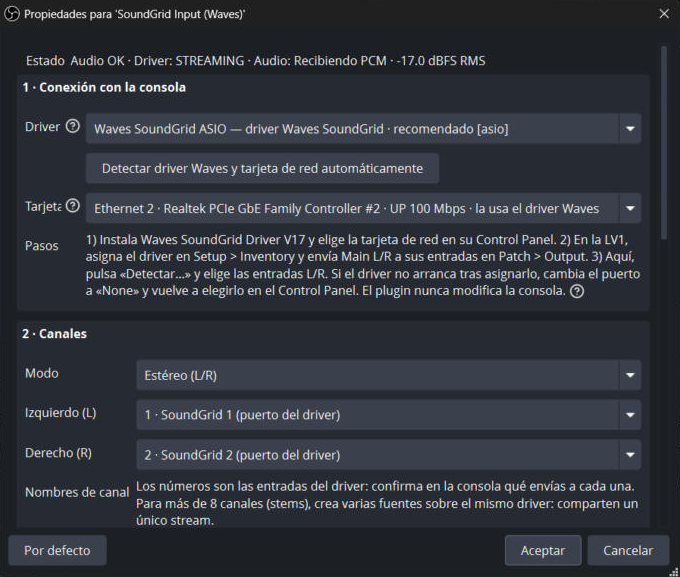
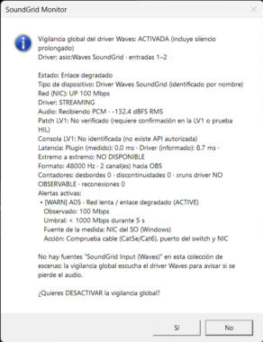
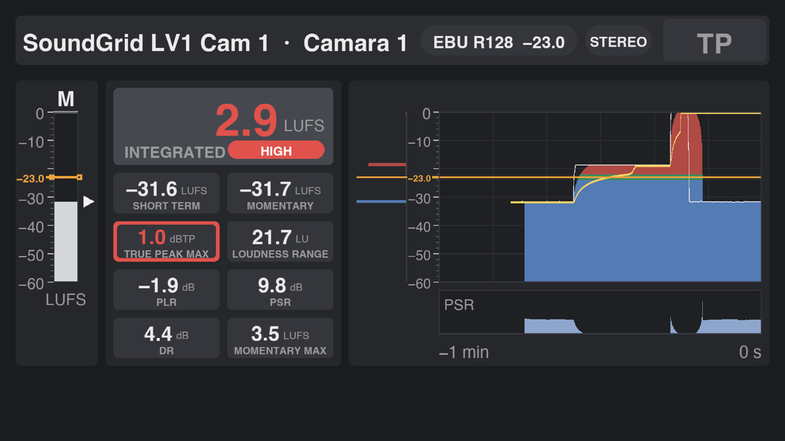
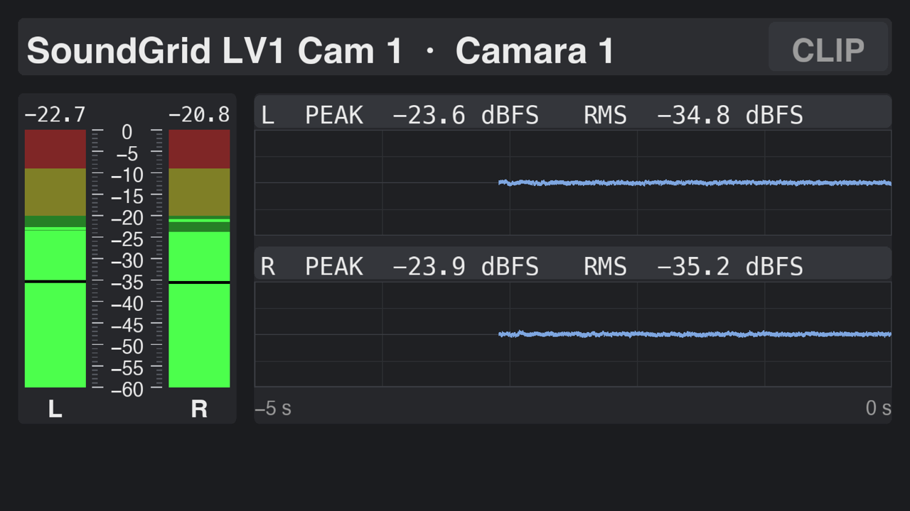
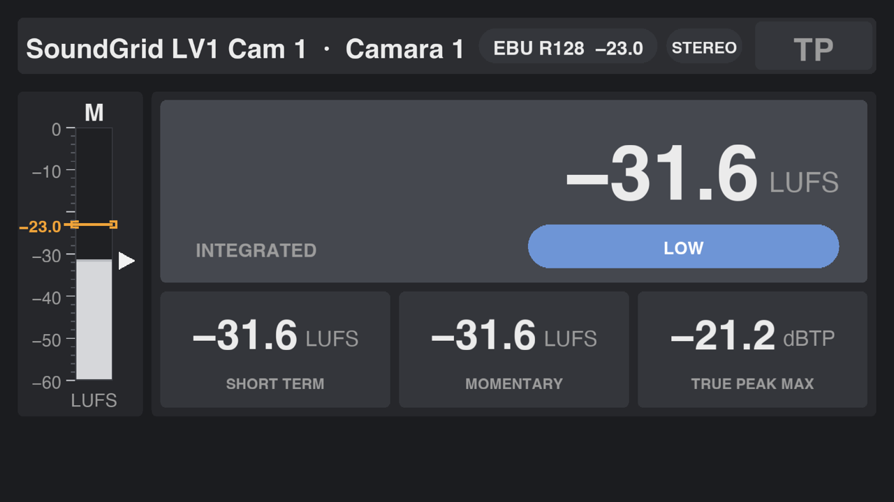

# OBS SoundGrid Input

Plugin para **OBS Studio** que recibe el audio de una consola **Waves eMotion LV1 Classic V17** a través del **Waves SoundGrid Driver V17** y avisa en OBS, con una barra roja, en cuanto se deja de recibir audio.

> **Proyecto independiente.** No está afiliado, patrocinado ni respaldado por Waves Audio Ltd. ni por Steinberg. "Waves", "SoundGrid", "eMotion LV1" y "ASIO" son marcas de sus propietarios.


## Descargar e instalar (Windows)

1. Descarga **`obs-soundgrid-input-<versión>-windows-x64-setup.exe`** de la última versión en **[Releases](https://github.com/japalacioo/obs-soundgrid-input/releases/latest)**.
2. Cierra OBS.
3. Ejecuta el instalador y acepta el aviso de permisos de Windows.
   - El instalador **no está firmado digitalmente**: si Windows SmartScreen lo bloquea, pulsa **Más información > Ejecutar de todas formas**.
4. Abre OBS. El plugin ya vigila el driver Waves aunque no añadas nada; para llevar el audio de la consola a OBS, añade **Fuentes > + > SoundGrid Input (Waves)**.

Guía completa, con verificación del archivo, actualización, desinstalación e instalación desatendida: **[docs/INSTALL.md](docs/INSTALL.md)**.

### Requisitos
| | |
|---|---|
| Sistema | Windows 10 u 11 de 64 bits |
| OBS Studio | 33.x de 64 bits (probado con 33.0.1) |
| Waves | **SoundGrid Driver V17** instalado con Waves Central (probado con 17.3.37.122) |
| Red | Tarjeta de red Gigabit conectada a la red SoundGrid de la consola |
| Consola | eMotion LV1 Classic V17 con el driver del PC asignado en Setup > Inventory |

El plugin **requiere el driver de Waves**: no habla el protocolo SoundGrid por sí mismo (es propietario y no tiene SDK público).

## Descargar e instalar (macOS, experimental)

1. Descarga **`obs-soundgrid-input-<versión>-macos-universal.pkg`** de **[Releases](https://github.com/japalacioo/obs-soundgrid-input/releases/latest)**. Es un binario universal: Apple Silicon e Intel.
2. Cierra OBS y abre el `.pkg`. Se instala solo para tu usuario, en `~/Library/Application Support/obs-studio/plugins/`, y no pide contraseña.
   - El instalador **no está firmado**: si macOS lo bloquea, ve a **Ajustes del Sistema > Privacidad y seguridad > Abrir igualmente**.
3. Abre OBS y acepta el permiso de **micrófono**; sin él, Core Audio no entrega audio.
4. Añade **Fuentes > + > SoundGrid Input (Waves)** y elige a mano la **tarjeta de red** del Control Panel de Waves (en Mac no se detecta sola).

Guía completa, con verificación del archivo, configuración de Waves, actualización, desinstalación, instalación desatendida y ZIP: **[docs/INSTALL.md#macos](docs/INSTALL.md#macos)**.

### Requisitos
| | |
|---|---|
| Sistema | macOS 11 o posterior, Apple Silicon o Intel (probado en macOS 26 con Apple Silicon). El SoundGrid Driver V17 pide macOS 14 Sonoma o posterior |
| OBS Studio | 30 o posterior (probado con 33.0.2) |
| Waves | **SoundGrid Driver V17 para Mac** instalado con Waves Central (sin probar con este plugin) |
| Red | Puerto Ethernet Gigabit (integrado o adaptador USB-C) conectado a la red SoundGrid de la consola |
| Consola | eMotion LV1 Classic V17 con el driver del Mac asignado en Setup > Inventory |

**Diferencias con Windows:** no se ha probado con hardware Waves en Mac; todavía no hay barra roja (las alertas salen en el panel de la fuente, el log de OBS y `alerts.jsonl`); el plugin no abre el Control Panel de Waves. La vigilancia global y el monitor del Multiview sí funcionan.

## Qué hace

- **Fuente de audio "SoundGrid Input (Waves)"**: lleva a OBS las entradas del driver Waves en estéreo, mono o multicanal (hasta 8 canales por fuente). Varias fuentes comparten un único stream del driver (stems sin reabrirlo).
- **Aviso rojo en la parte superior de OBS** si deja de llegar audio: sin muestras, driver caído, cable desconectado o silencio prolongado. Ámbar mientras se verifica la vuelta y verde al recuperarse. Un clic abre el panel.
  - Funciona **aunque no haya fuentes**: la vigilancia global escucha el driver Waves (entradas 1–2).
- **Configuración guiada**: detecta el driver Waves y la tarjeta de red que usa su Control Panel. Las fuentes nuevas se preconfiguran solas.
- **Panel de estado** de cada fuente con indicadores independientes: red, driver, audio, patch, consola y latencia. Desde ahí se pueden reconocer alertas, silenciar avisos 10 min (la detección sigue), reconectar el receptor y exportar un diagnóstico.
- **Mantiene abiertos** el SoundGrid Driver Control Panel y el servicio de Waves, y los reabre si se cierran (minimizados, sin quitar el foco a OBS).
- **Alertas A01–A10** con causa raíz (un cable suelto produce un solo aviso), perfiles Ensayo, Transmisión y Grabación, reconexión automática del receptor y registros sin IP ni MAC (log de OBS y `alerts.jsonl`).
- **Monitor de audio en el Multiview**, para el operador de la consola que ve el Multiview en otra pantalla ([docs/AUDIO_MONITOR.md](docs/AUDIO_MONITOR.md)). Tiene dos vistas con el mismo estilo (tema oscuro o claro) y se cambia entre ellas en las propiedades, en Herramientas o con un atajo:
  - **Sonoridad (LUFS)**, según ITU-R BS.1770-4 y al estilo de Youlean Loudness Meter: momentary, short-term, integrated, true peak, LRA, PLR, PSR y DR; historial, distribución y dinámica; objetivos EBU R128, ATSC A/85, streaming, YouTube, podcast, Netflix o personalizado, con alerta de true peak; reinicio y modo compacto para usarlo en una escena. Puede medir la fuente de la escena al aire, una fuente fija o la mezcla maestra.
  - **Clásica:** medidores L/R verde, amarillo y rojo (como el medidor de OBS) con escala en dBFS y peak hold; osciloscopio de los últimos segundos que avanza de derecha a izquierda; Peak y RMS en dBFS; indicador de clip; nombre de la fuente y de la escena.
  - Muestra la fuente SoundGrid de la escena al aire (o de la vista previa, o una fuente fija), aunque cada escena tenga su propia fuente.
  - La escena del monitor **se crea sola al abrir OBS**. Si alguien la pulsa, el plugin vuelve a la escena anterior para que nunca salga al aire.
- **Simulador** de 32 canales (tonos, ruido rosa, silencio, impulsos y señal saturada, con fallo de flujo) para probar mapas de canales, stems y alertas sin hardware.
- Interfaz e instalador en **español e inglés**.
- **Nunca modifica la consola**: no cambia patch, reloj, ganancia ni escenas de la LV1.

| Panel de la fuente | Sin fuentes: Herramientas > SoundGrid Monitor |
|---|---|
|  |  |



| Vista clásica | Sonoridad, modo compacto |
|---|---|
|  |  |

## Estado del proyecto

Versión **0.4.0** · laboratorio. Ver [notas de versión](docs/RELEASE_NOTES.md).

- **Probado con hardware Waves (parcial):** audio de una LV1 Classic V17 por el driver SoundGrid V17 hasta OBS 33.0.1 en Windows 11; avisos de silencio y recuperación con la consola real.
- **Monitor del Multiview:** probado en Windows 11 con OBS 33.0.1 (Direct3D 11) y en macOS 26 con OBS 33.0.2, con el simulador.
- **Medidor de sonoridad (sin publicar):** probado en macOS 26 con OBS 33.0.2 y el simulador; sin probar en Windows ni con audio real de la LV1.
- **Pruebas automáticas:** 142 en Windows (v0.4.0) y 176 en macOS con el medidor de sonoridad, todas PASS, incluidas las de libobs real y render por GPU.
- **Sin probar todavía:** sesiones largas con la consola, reconexión con audio real, confirmación del patch con un operador y macOS con hardware Waves.
- **No lo uses en un show** sin hacer antes las pruebas de [tests/hil/HIL_PROCEDURE.md](tests/hil/HIL_PROCEDURE.md) en tu sistema. Detalles en [docs/LIMITATIONS.md](docs/LIMITATIONS.md).

## Documentación

**Para usar el plugin**

| | |
|---|---|
| Instalar, actualizar, desinstalar y primera configuración | [docs/INSTALL.md](docs/INSTALL.md) |
| Avisos y alertas | [docs/ALERTS.md](docs/ALERTS.md) |
| Monitor de audio en el Multiview | [docs/AUDIO_MONITOR.md](docs/AUDIO_MONITOR.md) |
| Problemas frecuentes | [docs/TROUBLESHOOTING.md](docs/TROUBLESHOOTING.md) |
| Ejemplos de uso (Main L/R, bus de streaming, stems) | [docs/PROFILES.md](docs/PROFILES.md) |
| Limitaciones conocidas | [docs/LIMITATIONS.md](docs/LIMITATIONS.md) |
| Novedades por versión | [docs/RELEASE_NOTES.md](docs/RELEASE_NOTES.md) |

**Para desarrollar**

| | |
|---|---|
| Arquitectura y decisiones | [docs/ARCHITECTURE.md](docs/ARCHITECTURE.md) · [ADR](docs/ADR/README.md) |
| Pruebas | [docs/TEST_PLAN.md](docs/TEST_PLAN.md) · [docs/TEST_REPORT.md](docs/TEST_REPORT.md) · [HIL](tests/hil/HIL_PROCEDURE.md) |
| Publicar una versión (Windows y macOS) | [docs/RELEASING.md](docs/RELEASING.md) |
| Viabilidad y compatibilidad | [docs/FEASIBILITY.md](docs/FEASIBILITY.md) · [docs/COMPATIBILITY_MATRIX.md](docs/COMPATIBILITY_MATRIX.md) |
| Especificación de diseño original | [Plan](PLAN_AGENTE_OBS_WAVES_LV1_CLASSIC_V17_WINDOWS_MACOS.md) · [SDD](SDD_AGILES_OBS_SOUNDGRID_WINDOWS_MACOS.md) · [specs/](specs/) |
| Contribuir | [CONTRIBUTING.md](CONTRIBUTING.md) |
| Licencias de terceros | [docs/LICENSING.md](docs/LICENSING.md) |

## Compilar desde el código (Windows)

Requisitos: Visual Studio 2022 con C++, CMake 3.28 o superior, Git y OBS Studio 33 instalado. Para el instalador, Inno Setup 6.

```bash
powershell -ExecutionPolicy Bypass -File tools/make-obs-sdk.ps1
```

```bash
cmake -S . -B build -G "Visual Studio 17 2022" -A x64 -DSG_OBS_SDK_DIR=.deps/obs-sdk
```

```bash
cmake --build build --config Release
```

```bash
ctest --test-dir build -C Release --output-on-failure
```

```bash
powershell -ExecutionPolicy Bypass -File packaging/windows/build-installer.ps1
```

`tools/make-obs-sdk.ps1` descarga las cabeceras de OBS de la misma versión que tienes instalada y genera las bibliotecas de importación. Detalles en [CONTRIBUTING.md](CONTRIBUTING.md).

## Compilar desde el código (macOS)

Requisitos: Xcode Command Line Tools, CMake 3.28 o superior y OBS Studio 30+ en `/Applications`.

```bash
tools/make-obs-sdk.sh
```

```bash
cmake -S . -B build-macos -DCMAKE_BUILD_TYPE=Release -DSG_OBS_SDK_DIR=$PWD/.deps/obs-sdk
```

```bash
cmake --build build-macos -j8 && ctest --test-dir build-macos --output-on-failure
```

```bash
packaging/macos/package.sh build-macos
```

El `.pkg` y el `.zip` universales quedan en `dist/`.

## Estructura del código

```
src/common          reloj, tipos y ajustes
src/audio           anillos SPSC, conversión, mapeo, medidores y timestamps
src/transport       IAudioTransport, simulador, DeviceHub y TransportManager
src/platform        ASIO, NIC y aplicaciones de Waves (Windows); Core Audio y NIC (macOS)
src/observability   motor de alertas, aviso de audio perdido y registros
src/core            sesión por fuente, monitor y runtime
src/monitor         monitor del Multiview: historial, niveles, forma de onda, sonoridad BS.1770-4, estilo y distribución
src/obs             módulo OBS: fuente, panel, aviso en la ventana, vigilancia global y monitor del Multiview
tests/              unitarias, integración y render con libobs real, resistencia, sonda HIL
packaging/          instalador (Inno Setup) y ZIP de Windows; .pkg y ZIP universales de macOS
```

## English summary

OBS Studio plugin that captures audio from a **Waves eMotion LV1 Classic V17** console through the **Waves SoundGrid Driver V17** (ASIO on Windows; Core Audio on macOS, experimental) and shows a **red banner at the top of OBS** when audio is lost (no samples, driver lost, cable unplugged or prolonged silence), even with no source added. It also keeps the SoundGrid Driver Control Panel open and adds an **audio monitor to the OBS Multiview** for the console operator: L/R meters with dBFS scale and peak hold, a scrolling oscilloscope, Peak/RMS, a clip indicator and the name of the SoundGrid source of the on-air scene, or a loudness view (ITU-R BS.1770-4, like Youlean Loudness Meter) with momentary, short-term and integrated LUFS, true peak, LRA, PLR, PSR and DR against EBU R128, ATSC A/85 or streaming targets. Download the Windows installer or the experimental universal macOS `.pkg` from [Releases](https://github.com/japalacioo/obs-soundgrid-input/releases/latest); the installer and the plugin UI are available in English and Spanish. On macOS there is no red banner yet (alerts go to the source panel and the OBS log) and it has not been tested with Waves hardware. Status: laboratory, partially tested with real Waves hardware on Windows. Not affiliated with Waves Audio. License: GPLv3.

## Créditos y licencia

Desarrollado por **Joan Palacio**.

Contribuciones de **Mateo Salazar**:
- Compilación e instalador `.pkg` universal para macOS, y prueba de integración con libobs real en macOS.
- Monitor de audio en el Multiview (v0.4.0), con sus pruebas unitarias y de render por GPU.
- Medidor de sonoridad ITU-R BS.1770-4 en el monitor del Multiview y estilo común de sus dos vistas.

Copyright (C) 2026 Joan Palacio. Licencia **GPLv3 o posterior** ([LICENSE](LICENSE)). Incluye cabeceras ASIO del proyecto OBS bajo GPLv3 ([docs/LICENSING.md](docs/LICENSING.md)). Para informar de un problema de seguridad, ver [SECURITY.md](SECURITY.md).
