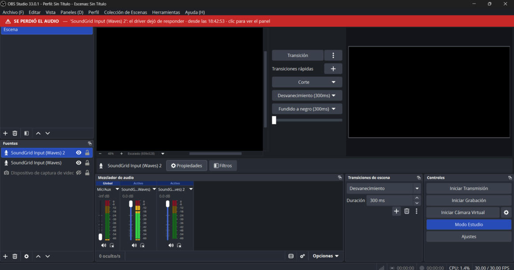

# OBS SoundGrid Input

Plugin para **OBS Studio** que recibe el audio de una consola **Waves eMotion LV1 Classic V17** a través del **Waves SoundGrid Driver V17** y avisa en OBS, con una barra roja, en cuanto se deja de recibir audio.

> **Proyecto independiente.** No está afiliado, patrocinado ni respaldado por Waves Audio Ltd. ni por Steinberg. "Waves", "SoundGrid", "eMotion LV1" y "ASIO" son marcas de sus propietarios.



## Descargar e instalar (Windows)

1. Descarga **`obs-soundgrid-input-<versión>-windows-x64-setup.exe`** de la última versión en **[Releases](https://github.com/japalacioo/obs-soundgrid-input/releases/latest)**.
2. Cierra OBS.
3. Ejecuta el instalador y acepta el aviso de permisos de Windows.
   - El instalador **no está firmado digitalmente**: si Windows SmartScreen lo bloquea, pulsa **Más información > Ejecutar de todas formas**.
4. Abre OBS. El plugin ya vigila el driver Waves aunque no añadas nada; para llevar el audio de la consola a OBS, añade **Fuentes > + > SoundGrid Input (Waves)**.

Guía completa, con verificación del archivo, actualización, desinstalación e instalación desatendida: **[docs/INSTALL.md](docs/INSTALL.md)**.

### Requisitos
| | |
|---|---|
| Sistema | Windows 10 u 11 de 64 bits |
| OBS Studio | 33.x de 64 bits (probado con 33.0.1) |
| Waves | **SoundGrid Driver V17** instalado con Waves Central (probado con 17.3.37.122) |
| Red | Tarjeta de red Gigabit conectada a la red SoundGrid de la consola |
| Consola | eMotion LV1 Classic V17 con el driver del PC asignado en Setup > Inventory |

El plugin **requiere el driver de Waves**: no habla el protocolo SoundGrid por sí mismo (es propietario y no tiene SDK público). macOS (experimental): hay instalador `.pkg` universal que carga en OBS 33, pero **no se ha probado con hardware Waves** y no tiene barra roja; ver [docs/INSTALL.md](docs/INSTALL.md#macos).

## Qué hace

- **Fuente de audio "SoundGrid Input (Waves)"**: lleva a OBS las entradas del driver Waves en estéreo, mono o multicanal (hasta 8 canales por fuente). Varias fuentes comparten un único stream del driver (stems sin reabrirlo).
- **Aviso rojo en la parte superior de OBS** si deja de llegar audio: sin muestras, driver caído, cable desconectado o silencio prolongado. Ámbar mientras se verifica la vuelta y verde al recuperarse. Un clic abre el panel.
  - Funciona **aunque no haya fuentes**: la vigilancia global escucha el driver Waves (entradas 1–2).
- **Configuración guiada**: detecta el driver Waves y la tarjeta de red que usa su Control Panel.
- **Mantiene abiertos** el SoundGrid Driver Control Panel y el servicio de Waves, y los reabre si se cierran (minimizados, sin quitar el foco a OBS).
- **Alertas A01–A10** con causa raíz (un cable suelto produce un solo aviso), reconexión automática del receptor y registros sin IP ni MAC.
- **Monitor de audio en el Multiview**: en el recuadro inferior derecho, medidores L/R, osciloscopio, Peak/RMS, indicador de clip y nombre de la fuente SoundGrid de la escena al aire, para el operador de la consola ([docs/AUDIO_MONITOR.md](docs/AUDIO_MONITOR.md)).
- **Nunca modifica la consola**: no cambia patch, reloj, ganancia ni escenas de la LV1.

| Panel de la fuente | Sin fuentes: Herramientas > SoundGrid Monitor |
|---|---|
|  |  |

## Estado del proyecto

Versión **0.3.0** · laboratorio. Ver [notas de versión](docs/RELEASE_NOTES.md).

- **Probado con hardware Waves (parcial):** audio de una LV1 Classic V17 por el driver SoundGrid V17 hasta OBS 33.0.1 en Windows 11; avisos de silencio y recuperación con la consola real.
- **Sin probar todavía:** sesiones largas con la consola, reconexión con audio real, confirmación del patch con un operador y macOS.
- **No lo uses en un show** sin hacer antes las pruebas de [tests/hil/HIL_PROCEDURE.md](tests/hil/HIL_PROCEDURE.md) en tu sistema. Detalles en [docs/LIMITATIONS.md](docs/LIMITATIONS.md).

## Documentación

**Para usar el plugin**

| | |
|---|---|
| Instalar, actualizar, desinstalar y primera configuración | [docs/INSTALL.md](docs/INSTALL.md) |
| Avisos y alertas | [docs/ALERTS.md](docs/ALERTS.md) |
| Monitor de audio en el Multiview | [docs/AUDIO_MONITOR.md](docs/AUDIO_MONITOR.md) |
| Problemas frecuentes | [docs/TROUBLESHOOTING.md](docs/TROUBLESHOOTING.md) |
| Ejemplos de uso (Main L/R, bus de streaming, stems) | [docs/PROFILES.md](docs/PROFILES.md) |
| Limitaciones conocidas | [docs/LIMITATIONS.md](docs/LIMITATIONS.md) |
| Novedades por versión | [docs/RELEASE_NOTES.md](docs/RELEASE_NOTES.md) |

**Para desarrollar**

| | |
|---|---|
| Arquitectura y decisiones | [docs/ARCHITECTURE.md](docs/ARCHITECTURE.md) · [ADR](docs/ADR/README.md) |
| Pruebas | [docs/TEST_PLAN.md](docs/TEST_PLAN.md) · [docs/TEST_REPORT.md](docs/TEST_REPORT.md) · [HIL](tests/hil/HIL_PROCEDURE.md) |
| Viabilidad y compatibilidad | [docs/FEASIBILITY.md](docs/FEASIBILITY.md) · [docs/COMPATIBILITY_MATRIX.md](docs/COMPATIBILITY_MATRIX.md) |
| Especificación de diseño original | [Plan](PLAN_AGENTE_OBS_WAVES_LV1_CLASSIC_V17_WINDOWS_MACOS.md) · [SDD](SDD_AGILES_OBS_SOUNDGRID_WINDOWS_MACOS.md) · [specs/](specs/) |
| Contribuir | [CONTRIBUTING.md](CONTRIBUTING.md) |
| Licencias de terceros | [docs/LICENSING.md](docs/LICENSING.md) |

## Compilar desde el código (Windows)

Requisitos: Visual Studio 2022 con C++, CMake 3.28 o superior, Git y OBS Studio 33 instalado. Para el instalador, Inno Setup 6.

```bash
powershell -ExecutionPolicy Bypass -File tools/make-obs-sdk.ps1
```

```bash
cmake -S . -B build -G "Visual Studio 17 2022" -A x64 -DSG_OBS_SDK_DIR=.deps/obs-sdk
```

```bash
cmake --build build --config Release
```

```bash
ctest --test-dir build -C Release --output-on-failure
```

```bash
powershell -ExecutionPolicy Bypass -File packaging/windows/build-installer.ps1
```

`tools/make-obs-sdk.ps1` descarga las cabeceras de OBS de la misma versión que tienes instalada y genera las bibliotecas de importación. Detalles en [CONTRIBUTING.md](CONTRIBUTING.md).

```
src/common          reloj, tipos y ajustes
src/audio           anillos SPSC, conversión, mapeo, medidores y timestamps
src/transport       IAudioTransport, simulador, DeviceHub y TransportManager
src/platform        ASIO, NIC y aplicaciones de Waves (Windows); Core Audio y NIC (macOS)
src/observability   motor de alertas, aviso de audio perdido y registros
src/core            sesión por fuente, monitor y runtime
src/obs             módulo OBS: fuente, panel, aviso en la ventana y vigilancia global
tests/              unitarias, integración con libobs real, resistencia, sonda HIL
packaging/          instalador (Inno Setup) y ZIP de Windows; paquete macOS (sin probar)
```

## English summary

OBS Studio plugin that captures audio from a **Waves eMotion LV1 Classic V17** console through the **Waves SoundGrid Driver V17** (ASIO, Windows) and shows a **red banner at the top of OBS** when audio is lost (no samples, driver lost, cable unplugged or prolonged silence), even with no source added. It also keeps the SoundGrid Driver Control Panel open. Download the Windows installer from [Releases](https://github.com/japalacioo/obs-soundgrid-input/releases/latest); the installer and the plugin UI are available in English and Spanish. Status: laboratory, partially tested with real Waves hardware. Not affiliated with Waves Audio. License: GPLv3.

## Créditos y licencia

Desarrollado por **Joan Palacio**.

Copyright (C) 2026 Joan Palacio. Licencia **GPLv3 o posterior** ([LICENSE](LICENSE)). Incluye cabeceras ASIO del proyecto OBS bajo GPLv3 ([docs/LICENSING.md](docs/LICENSING.md)). Para informar de un problema de seguridad, ver [SECURITY.md](SECURITY.md).
