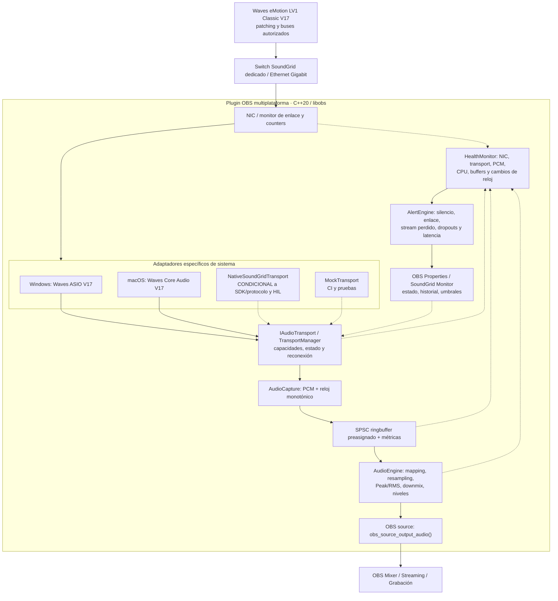

# SDD ágiles — OBS SoundGrid Input (Windows y macOS)

**Proyecto:** receptor de audio para OBS Studio desde Waves eMotion LV1 Classic V17.  
**Versión del documento:** 2.2 · **Fecha:** 2026-11-16 · **Estado:** especificación para desarrollo, **no** software construido.  
**Enfoque:** Spec-Driven Development (SDD): especificación verificable → prueba que falla → implementación mínima → refactorización → evidencia de aceptación.  
**Plataformas objetivo del plugin:** Windows 10/11 x64; macOS Intel x64 y Apple Silicon arm64 (binario universal cuando sea viable). **Otras plataformas quedan fuera de alcance.**

> **Advertencia crítica:** la compatibilidad del *plugin OBS* no equivale a recepción SoundGrid nativa sin driver. Waves documenta SoundGrid Driver V17 en **Windows (ASIO)** y **macOS (Core Audio)**. SoundGrid es propietario. La experiencia sin driver ni panel requiere integración autorizada y pruebas HIL en una LV1 Classic V17 real; no se deben declarar funciones no verificadas.

## 0. Contrato de ejecución para el agente

1. **Alcance fijo:** plugin OBS para Windows y macOS, código compartido C++20, fuente de audio nativa, selección de canales realmente disponibles, panel de estado/alertas, recuperación y empaquetado por OS.
2. **Objetivo de experiencia:** conectar Ethernet, abrir OBS y encontrar canales de la LV1 sin abrir SoundGrid Driver Panel. **Este objetivo completo es condicional**; en la ruta oficial puede requerirse instalación/configuración inicial del driver, selección NIC, asignación en `Setup > Inventory` y patch en LV1.
3. **Entrega incremental:** cada SDD se implementa en rama/PR pequeño, con especificación, código, pruebas, informe de resultados y actualización de matriz de compatibilidad. Un agente no avanzará afirmando éxito de hardware usando solo mocks.
4. **Seguridad de show:** prohibido modificar la mezcla FOH, ganancia, mute, escenas, reloj o patch durante eventos; cualquier escritura a LV1 exige permiso explícito y modo laboratorio.
5. **Sin inventar integraciones:** no presentar detección de NIC como detección de LV1, ni nombre genérico de driver como catálogo de canales, ni ausencia de error como recepción de PCM.
6. **Audio RT:** no hacer asignaciones, logging, locks bloqueantes, UI, red ni operaciones de disco desde callbacks de captura/audio. Captura en buffers preasignados y transferencia por cola acotada.
7. **Licencias:** revisar GPL de OBS/plantilla, licencia del SDK ASIO, dependencias, redistribución de Waves y condiciones de firma en macOS antes del release.
8. **Trabajo en 2 SO desde el comienzo:** todos los SDD de núcleo llevan pruebas de CI en Windows y macOS aunque todavía no haya hardware conectado.
9. **Formato de estados:** `NO_EVALUADO`, `SIMULADO`, `COMPILA`, `PROBADO_LOCAL`, `PROBADO_HIL`, `BLOQUEADO`, `NO_SOPORTADO`. Cada función se desglosa por OS.
10. **No modificar el protocolo de producción:** las pruebas de paquetes/red, si son autorizadas, se realizan en laboratorio separado; evitar escaneos/sondeos agresivos a SoundGrid.

## 1. Viabilidad y matriz de compatibilidad (alcance exclusivo Windows / macOS)

| Capacidad | Windows 10/11 x64 | macOS Intel / Apple Silicon |
|---|---|---|
| Compilar plugin OBS y pruebas sin hardware | Objetivo CI | Objetivo CI por arquitectura disponible |
| Fuente simulada en OBS | Objetivo P0 | Objetivo P0 |
| Driver Waves SoundGrid V17 | ASIO V17 | Core Audio V17 |
| Captura real de LV1 con driver Waves | Ruta A; HIL obligatorio | Ruta A; HIL obligatorio por arquitectura |
| API de audio genérica | WASAPI opcional; no reemplaza ASIO | Core Audio |
| Recepción SoundGrid nativa sin driver | Ruta B condicionada | Ruta B condicionada |
| Detección LV1, nombres de canales y patch | Solo mediante integración autorizada y verificada | Solo mediante integración autorizada y verificada |
| Medidores, alertas, reconexión y UI | P0 | P0 |
| Distribución básica | Instalador/ZIP Windows | Plugin macOS y firma/notarización si procede |
| Certificación LV1 | Solo tras HIL real | Solo tras HIL real con Intel/Apple Silicon según equipos |

**Notas macOS:** una compilación universal no certifica el driver Waves en cada chip. Comprobar Core Audio, permisos, compatibilidad de arquitectura y dropouts reales por combinación de versión de macOS, OBS y Waves V17. Registrar cualquier restricción de Rosetta o instalación basada en instrucciones oficiales verificadas.

**Regla UX:** no identificar una consola por detectar un puerto Ethernet. Mostrar por separado `Adaptador Ethernet`, `Dispositivo Waves`, `Rutas asignadas` y `PCM recibido`; cada estado exige evidencia.

## 2. Arquitectura técnica detallada



### 2.1 Contratos estrictos

- `IAudioTransport`: `enumerateDevices()`, `getCapabilities()`, `open(config)`, `start()`, `stop()`, `close()`, `snapshot()` y callback entrega de PCM. Contratos de threading y errores documentados.
- `TransportCapabilities`: `canCapturePcm`, `canDiscoverSoundGridNodes`, `canReadLv1ChannelNames`, `canControlPatching`, `requiresWavesDriver`, `requiresHostConfiguration`, `isHardwareValidated`; todos proceden de evidencia de adaptador, **nunca** de suposiciones.
- `AudioFormat`: frecuencia, tipo de muestra, orden de canales, número de canales, tamaño de frame, reloj y timestamp monotónico.
- `HealthSnapshot`: fuente/OS, instante, carrier, velocidad, errors, `pcmFramesReceived`, gap máximo, xrun, uso de buffer, clipping, RMS/peak por canal, método de estimación de latencia y grado de confianza.
- `AlertEvent`: `id`, `rule`, `severity`, `state`, `startedAt`, `endedAt`, `evidence` (valor observado, umbral, causa, confianza y fuente de la medición), `correlationId`, `platform`, `affectedSource`. Separar `ACTIVE`, `ACKNOWLEDGED`, `RECOVERING`, `RESOLVED`; `RECOVERED` es la etiqueta visible de A10 al pasar a `RESOLVED`.
- `IChannelCatalog`: lista de **canales expuestos** al receptor (índice y mapeo), y nombres reales LV1 solo cuando un origen fiable los proporcione. Fallback `Input 1..N`.
- `PlatformServices`: `INetworkTelemetry`, `IClock`, `ISettingsStore`, `IPlatformAudioEnumerator`, `INotificationSink`. El núcleo no incluye headers de OS.

### 2.2 Reglas de flujo de audio

- PCM `float32` interno, metadatos de formato explícitos; conversión a la estructura de audio que requiere OBS.
- Evitar sobrescritura de PCM con tiempo incorrecto; tiempos monotónicos y control de drift. Si se requiere resampling, preservar continuidad y registrar la latencia introducida.
- Los medidores deben consumir snapshots, sin bloquear ni ralentizar callback RT.
- Stop/restart idempotentes y seguros al cerrar OBS o cambiar escenas.
- Los diagnósticos de red no inyectarán tráfico de prueba en la red de producción.

## 3. SDD ágiles (backlog implementable)

**Fuente normativa:** este documento. Los archivos `specs/SDD-NN.md` son extractos de esta sección para trabajar por historia; todo cambio a un SDD se aplica aquí y en su extracto dentro del mismo cambio. Ante discrepancia con el plan maestro o con un extracto, prevalece este documento.

### SDD-00 — Feasibility / compatibilidad V17
**Prioridad:** P0 · **Dependencias:** ninguna · **Entregable:** `docs/FEASIBILITY.md`, `docs/COMPATIBILITY_MATRIX.md`, ADR-001 y ADR-002.

**Historia:** Como responsable técnico quiero saber qué puede hacer cada OS para no construir funciones sobre capacidades inexistentes.

**Diseño y tareas:** registrar matriz de versiones reales (OBS, Waves V17, CPU, NIC), evidencias oficiales de controladores Windows/macOS, requerimientos de ASIO SDK, permisos Core Audio, soporte ARM/macOS y disponibilidad de APIs SoundGrid. Identificar si LV1 Classic permite patch a computador receptor y cómo se confirma PCM. Solicitar acceso oficial a Waves si se necesita ruta B.

**Aceptación:** (a) decisión de ruta A/B por OS (ADR-002) con URL/fecha; (b) riesgos y bloqueos; (c) no afirmar recepción nativa sin driver sin prueba; (d) no aceptar mock como prueba HIL. **Pruebas:** revisión de ADR y matriz contra fuentes oficiales.

### SDD-01 — Repositorio, módulos y CI multiplataforma
**Prioridad:** P0 · **Dependencias:** 00 · **Entregable:** `CMakeLists.txt`, `CMakePresets.json`, pipeline y plugin vacío que carga en OBS.

**Historia:** Como desarrollador quiero compilar el mismo núcleo para Windows/macOS en cada PR.

**Diseño y tareas:** iniciar con `obsproject/obs-plugintemplate`, C++20, `libobs`, Qt6 solo si se requiere dock; runners Windows x64 y macOS Intel/arm64 o universal; análisis estático, clang-format, CTest y checks de empaquetado. Registrar versiones fijadas y artefactos separados por plataforma.

**Aceptación:** CI verde en 2 SO; OBS carga/desinstala el plugin sin crash; builds sin driver Waves. **Pruebas:** smoke de plugin, ABI, instalación y desinstalación en VM/host.

### SDD-02 — Abstracción IAudioTransport y Mock
**Prioridad:** P0 · **Dependencias:** 01 · **Entregable:** API y Mock con tonos, ruido, silencio, dropout, drift y desconexión.

**Historia:** Como QA quiero reproducir todos los fallos sin afectar una consola real.

**Diseño y tareas:** state machine `UNAVAILABLE→DISCOVERED→CONFIGURED→STREAMING→DEGRADED→RECONNECTING`; inyección controlada de audio estéreo/multicanal; simulador determinista con reloj virtual.

**Aceptación:** mismo núcleo en Windows y macOS, 2/8/16/32 canales simulados, stop/start repetibles, errores clasificables. **Pruebas:** fixtures bit-exact y cambios de estado.

### SDD-03 — Captura Windows SoundGrid ASIO V17
**Prioridad:** P0 (Windows) · **Dependencias:** 00,02 · **Entregable:** `AsioTransport`.

**Historia:** Como operador en Windows quiero recibir PCM parcheado desde LV1 sin abrir un DAW.

**Diseño y tareas:** enumeración ASIO, ciclo de vida driver, callbacks, buffers, formatos, canales y xrun; no abrir panel desde el flujo normal si la configuración persiste. Documentar instalación driver/selección NIC y patch iniciales que deban hacerse fuera del plugin.

**Aceptación:** capturar L/R real en HIL, medir discontinuidades, iniciar/detener 100 veces; no afirmar «sin driver». **Pruebas:** unit de conversiones; HIL 2/8/16 canales cuando disponibles, sesión 2 h sin cortes atribuibles al plugin.

### SDD-04 — Captura macOS Core Audio V17
**Prioridad:** P0 (macOS) · **Dependencias:** 00,02 · **Entregable:** `CoreAudioTransport`.

**Historia:** Como operador en Mac quiero usar el driver Waves instalado con el mismo panel de OBS.

**Diseño y tareas:** enumerar AudioDevices y streams Core Audio/HAL; seleccionar SoundGrid cuando se presente al OS; mapear formatos; reaccionar a cambios de dispositivos/frecuencia; verificar OBS nativo Intel y Apple Silicon, instalación Rosetta y permisos según las combinaciones reales. Probar comportamiento ante sleep/wake y cambios de red.

**Aceptación:** PCM real en macOS Intel y/o Apple Silicon únicamente donde HIL lo demuestre; registrar incompatibilidad y dropouts por combinación. **Pruebas:** HIL separado por CPU, reconexión y 2 h; jamás etiquetar «Universal = driver compatible».

### SDD-05 — Compatibilidad cruzada Windows/macOS y arranque automatizado
**Prioridad:** P0 · **Dependencias:** 01,02,03,04 · **Entregable:** `PlatformCompatibilitySuite`, checklist de arranque y documentación por plataforma.

**Historia:** Como operador quiero que el plugin funcione de forma coherente en Windows y Mac, con diagnósticos precisos cuando SoundGrid todavía no se pueda usar.

**Diseño y tareas:** validar la misma API `IAudioTransport` para ASIO y Core Audio; comprobar carga de plugin, dependencias, selección persistente de dispositivo/NIC, permisos, compatibilidad de arquitectura, autoarranque de fuentes OBS, reconexión y estado `CONFIGURATION_REQUIRED` cuando el driver o el patch necesitan pasos oficiales. No simular descubrimiento LV1 al detectar un controlador.

**Aceptación:** compilación y carga en OBS de Windows y macOS, pruebas de audio simulado idénticas, guías de instalación específicas, y estados de diagnóstico trazables. **Pruebas:** smoke de arranque/reinicio de OBS, persistencia, driver ausente, driver ocupado, sample rate cambiado y compatibilidad Intel/Apple Silicon.

### SDD-06 — Detección de NIC y capacidades reales por OS
**Prioridad:** P0 · **Dependencias:** 01,02 · **Entregable:** `INetworkTelemetry` con implementaciones por plataforma.

**Historia:** Como operador quiero distinguir cable desconectado, NIC degradada y audio inexistente.

**Diseño y tareas:** Windows con IP Helper/Windows APIs, y macOS con APIs de red/Sysctl o equivalentes; capturar carrier, velocidad negociada, interfaz, contadores si disponibles. Los valores no disponibles se expresan como `UNKNOWN` (no cero). NIC seleccionada se guarda por identificador estable y se revalida.

**Aceptación:** cable conectado/desconectado cambia estado sin congelar OBS; NIC a 100 Mbps genera advertencia; sin contadores se informa limitación. **Pruebas:** mocks OS, cambios de NIC y permisos.

### SDD-07 — AudioEngine y compatibilidad con libobs
**Prioridad:** P0 · **Dependencias:** 02 · **Entregable:** buffers RT, conversión, salida OBS, resampler si aplica.

**Historia:** Como productor quiero audio continuo y sincronizable con el video en Windows y macOS.

**Diseño y tareas:** ring SPSC preasignado, contador de pérdida, mapeo PCM al formato `obs_source_audio`, timestamps monotónicos en nanosegundos, conversión 44.1/48/88.2/96k donde el transporte lo soporte, test de canales y reloj, downmix configurable sin afectar FOH.

**Aceptación:** ningún lock de UI/disco/red en hilo RT; 2/8/16/32 canales simulados, no desbordes, tolerancia a resync medida. **Pruebas:** WAV de referencia, pruebas de drift y stress >2 h bajo carga.

### SDD-08 — Selección de canales y metadatos verificables
**Prioridad:** P0 · **Dependencias:** 03/04/05,07 · **Entregable:** `IChannelCatalog` y UI de selección.

**Historia:** Como usuario quiero seleccionar Main L/R, buses y canales solamente si están disponibles para el receptor.

**Diseño y tareas:** catálogo de índices PCM expuestos; etiquetar `Input 1…N` si no hay API de nombres; selección persistente por fuente OBS; confirmación de patch mediante PCM/metadata observables, no adivinación. Distinguir «nombre suministrado por usuario» de «nombre reportado por LV1».

**Aceptación:** cambio de mapeo sin crash/ruido, 0 canales y canales fuera de rango gestionados; nunca anunciar Main L/R por defecto sin correspondencia verificada. **Pruebas:** mapeo stereo, swap, pérdida de canal.

### SDD-09 — Monitoreo, alertas e histéresis
**Prioridad:** P0 · **Dependencias:** 02,06,07 · **Entregable:** `HealthMonitor`, `AlertEngine` y reglas A01–A10.

**Historia:** Como operador quiero alertas claras sin falsas alarmas por silencios normales de una transmisión.

**Reglas iniciales configurables (no SLA ni cifras de hardware garantizadas):**

| ID | Regla | Umbral inicial | Evidencia principal |
|---|---|---|---|
| A01 | Silencio de fuente armada | RMS < -60 dBFS por 10 s, tras 3 s de gracia | PCM recibido + nivel bajo; silenciar regla si fuente no armada |
| A02 | Interrupción de stream | sin nuevos frames > 1 s | frame counter estancado estando `STREAMING` |
| A03 | Transporte/driver perdido | evento inmediato + debounce de 500 ms | error abierto/cerrado o estado driver |
| A04 | Red sin enlace | carrier DOWN confirmado > 1 s | estado NIC elegida |
| A05 | Enlace negociado lento | <1 Gbps sostenido 5 s | velocidad negociada, no throughput SoundGrid |
| A06 | Errores de NIC | incremento sostenido sobre línea base | contadores OS disponibles; `UNKNOWN` si no existen |
| A07 | Latencia alta | > 80 ms durante 5 s (inicial, calibrable); solo si medible | latencia real medida o etiqueta explícita «estimada» |
| A08 | Audio discontinuo | > 3 xruns/min (inicial) o exceso sostenido de cola 2 s | underrun/overrun y huecos de timestamp |
| A09 | Clipping | peak ≥ −0.1 dBFS en 3 ventanas dentro de 2 s | muestreo PCM, duración configurable |
| A10 | Recuperación | condición saludable sostenida 5 s | señal/restablecimiento de stream + red/driver |

**Diseño y tareas:** ventana temporal configurable, debounce/histéresis, supresión por jerarquía de causas (`NIC DOWN` suprime alertas redundantes de stream), severidad `INFO/WARN/CRITICAL`, acknowledgment sin silenciar audio, eventos con evidencia y método de medición. No medir «latencia total de extremo a extremo» sin reloj/instrumentación válida.

**Aceptación:** 10 reglas probadas en Windows/macOS con clock virtual; silencio deliberado sin PCM es distinguible de PCM silencioso; correlación evita tormenta de alertas. **Pruebas:** 10 reglas × trigger/resolución + regresiones persistencia.

### SDD-10 — Reconexión y resiliencia
**Prioridad:** P0 · **Dependencias:** 02,03/04/05,09 · **Entregable:** máquina de estados y backoff.

**Historia:** Como operador quiero que se recupere una conexión sin detener ni bloquear OBS.

**Diseño y tareas:** reintentos limitados y exponenciales con jitter; no reconectar por silencio legítimo; manejar driver reiniciado, cable retirado, cambio de NIC, sleep/resume, cambio de sample rate; state snapshots y reinicio seguro sin leaks.

**Aceptación:** OBS sigue vivo y fuente muestra estado correcto; reconexión cuando se recupera transporte y enrutamiento; jamás modificar estado de la consola. **Pruebas:** 1000 ciclos con Mock, 20 ciclos de interrupción controlada HIL por OS disponible.

### SDD-11 — UX multiplataforma SoundGrid Monitor
**Prioridad:** P1 · **Dependencias:** 06,08,09 · **Entregable:** propiedades OBS, dock opcional, traducciones.

**Historia:** Como operador quiero una UX coherente de estado, selección y alertas en ambos SO.

**Diseño y tareas:** `obs_properties_t` primero; Qt6 dock opcional ajustado a ABI OBS; vistas `Conexión`, `Canales`, `Audio`, `Alertas`, `Diagnósticos`. Etiquetas accesibles y logs exportables sin secretos. Mostrar claramente `Driver Waves no disponible` o `Configuración requerida` según diagnóstico.

**Aceptación:** UI sin congelamientos, accesible, persiste por escena/fuente; misma semántica en Windows/macOS. **Pruebas:** smoke UI por OS, escalado DPI, cambio tema.

### SDD-12 — Seguridad, configuración y telemetría
**Prioridad:** P1 · **Dependencias:** 01,09 · **Entregable:** settings versionados, logs, política de privacidad.

**Historia:** Como administrador quiero diagnósticos útiles sin exponer configuraciones ni alterar la red de producción.

**Diseño y tareas:** JSON de settings con migración y respaldo, rotación de logs, redacción de PII/identificadores sensibles, métricas locales por defecto, sin telemetría remota sin consentimiento; auditar dependencias y accesos al driver. Guardar rutas OS correctas, evitar permisos privilegiados.

**Aceptación:** upgrades conservan perfiles, export de diagnóstico no incluye secretos, rotación y reinstalación estables. **Pruebas:** settings corruptos, migración, permisos restringidos.

### SDD-13 — CI/CD, empaquetado y firmados
**Prioridad:** P1 · **Dependencias:** 01,07,11 · **Entregable:** releases reproducibles por OS.

**Historia:** Como usuario quiero instalar el plugin directamente en mi sistema.

**Diseño y tareas:** GitHub Actions matrix, artefactos con SHA256 y símbolos de depuración; Windows ZIP/installer firmado si certificado disponible; macOS bundle universal o arquitecturas separadas, codesign/notarización cuando haya credenciales; No empaquetar drivers Waves ni SDK restringidos sin licencia.

**Aceptación:** instala, OBS arranca, aparece la fuente, se elimina limpio; artefactos para 2 SO en cada release; matriz de compatibilidad visible. **Pruebas:** smoke en máquinas limpias, tests de firma y hashes.

### SDD-14 — Ruta B SoundGrid nativa y autorización
**Prioridad:** investigación bloqueante del objetivo «sin driver» · **Dependencias:** 00,02 · **Entregable:** `docs/NATIVE_FEASIBILITY.md` + ADR y PoC HIL solo si procede.

**Historia:** Como propietario quiero recibir audio LV1 sin driver/panel Waves, pero solo si es técnicamente posible y verificable.

**Diseño y tareas:** gestionar contacto con Waves para SDK/contrato, documentación de nodo, clock, streams y rutas; revisar seguridad/licencia; construir receptor de laboratorio detrás de `IAudioTransport` únicamente con base técnica autorizada. Ningún escaneo agresivo en producción.

**Aceptación de puerta:** (1) API/protocolo legalmente utilizable; (2) LV1 Classic V17 identificada; (3) patch/ruta audio establecida con control permitido; (4) PCM correcto, reloj y canales verificados; (5) ensayo 2 h con medidas de dropouts, latencia y reconexión; (6) Windows/macOS probados individualmente. Si no, estado `BLOQUEADO`, sin sustituir por suposiciones.

### SDD-15 — Pruebas HIL y validación de lanzamiento
**Prioridad:** P0 para cualquier claim de hardware · **Dependencias:** todas las funciones incluidas en release.

**Historia:** Como equipo técnico quiero publicar solo aquello probado con Waves LV1 Classic V17 real.

**Diseño y tareas:** checklist rack/switch/NIC/firmware, versión exacta de LV1 + driver, copia de configuración, autorización del responsable de sonido, patch reversible, señal de prueba, captura WAV de diagnóstico, CPU/RAM/xruns, jitter, reconexión y 2 h grabando. Evitar cualquier cambio en la mezcla FOH. Medir umbrales de calidad con instrumentación; no inferir latencia total desde tamaño de buffer.

**Aceptación:** reporte `tests/hil/TEST_REPORT-OS-CPU.md` firmado por responsable, evidencia de WAV y métricas, errores/limitaciones por OS. **Pruebas:** stereo L/R, 8/16 canales disponibles, cambio de cable bajo condiciones seguras, silencio PCM y corte de stream, CPU alta.

## 4. Cadencia ágil: incrementos verticales y puertas

Cada iteración debe terminar con una demostración o artefacto comprobable:

| Iteración | SDD | Demostración mínima | Puerta |
|---|---|---|---|
| I0 — Viabilidad | 00,14 (investigación) | Matriz Windows/macOS y autorización de rutas | G0: viabilidad evaluada |
| I1 — Núcleo y CI | 01,02 | fuente Mock en OBS en Windows y macOS | G1: CI de los dos SO |
| I2 — Motor RT | 07,08 | audio multicanal simulado | G2: sin bloqueos/desbordes |
| I3 — Captura por OS | 03,04,05 | ASIO y Core Audio con fallback y diagnóstico | G3: distinguir mock, driver y hardware |
| I4 — Operación | 06,09,10 | alertas + recuperación con fallos simulados | G4: reglas A01–A10 validadas |
| I5 — UX y entrega | 11,12,13 | instalador Windows y plugin macOS | G5: smoke, firma y licencias |
| I6 — Hardware | 15 + ruta B si G0 la autoriza | audio real LV1 por cada SO certificado | G6: HIL documentado |

**Paralelización:** los adaptadores Windows ASIO y macOS Core Audio pueden avanzar en paralelo cuando `IAudioTransport`, `AudioFrame` y las pruebas de núcleo estén estables. Las pruebas simuladas se ejecutan en ambos SO. La ruta sin driver no bloquea el MVP, pero tampoco se declara implementada.

## 5. Matriz de pruebas y definición de terminado

### 5.1 Matriz obligatoria

| Tipo | Windows x64 | macOS Intel | macOS Apple Silicon |
|---|---|---|---|
| Compilación y CTest | CI | CI/runner Intel | CI/runner arm64 |
| Mock 2/8/16/32 canales | Sí | Sí | Sí |
| Carga OBS y abrir/cerrar fuente | Sí | Sí | Sí |
| Alertas/reconexión simuladas | Sí | Sí | Sí |
| Instalación/desinstalación | Sí | Sí | Sí |
| Captura Waves real | HIL obligatorio | HIL por arquitectura | HIL por arquitectura |
| Audio 2 h continuo | Gate de release | Gate por arquitectura | Gate por arquitectura |

**Criterios no funcionales propuestos, sujetos a medición y ajuste:** cero bloqueos del proceso OBS por callback audio; cero asignaciones dinámicas ni logs en hilo RT; no tener cambios audibles al mostrar/cerrar dock; error de tiempo de audio registrado cuando no pueda estimarse; recuperación de UI sin requerir reinicio de OBS salvo fallos externos documentados; memoria estable en prueba de 2 horas; la pérdida de paquetes/latencia nunca se inventa si no hay telemetría válida. Un «0» no sustituye `UNKNOWN`.

### 5.2 Definition of Done por SDD

- [ ] Documento SDD actualizado y ADR si cambió decisión de arquitectura.
- [ ] Código modular sin compilación condicional fuera del adaptador OS, salvo puntos de entrada/preset.
- [ ] Pruebas unitarias y de integración pasan en CI Windows/macOS donde aplique.
- [ ] Evidencia HIL real agregada **solo** cuando hubo consola física, driver y patch reales.
- [ ] Alertas no se activan de forma errónea ante silencios programados y no hay tormentas de notificaciones.
- [ ] Build instalable y verificado sin tocar mix en consola.
- [ ] Estado por OS y capacidad actualizado (`SIMULADO`, `HIL`, `BLOQUEADO`, etc.).
- [ ] Documentación de limitaciones, licencias y pasos de instalación específica por OS.

### 5.3 Ejemplos de aceptación Gherkin

```gherkin
Escenario: el plugin distingue dispositivo Waves de interfaz Ethernet
  Dado OBS instalado en Windows o macOS
  Y una NIC Ethernet conectada
  Y ningún dispositivo Waves SoundGrid confirmado
  Cuando abro el selector de dispositivos
  Entonces veo que la NIC está disponible
  Y no se declara una consola LV1 detectada sin evidencia

Escenario: Silencio real con stream vivo
  Dado PCM llegando a la fuente en estado STREAMING
  Y la fuente está marcada para supervisión
  Cuando RMS permanece menor de -60 dBFS durante 10 segundos
  Entonces se activa A01 SILENCIO
  Y no se activa A02 PÉRDIDA DE STREAM

Escenario: Desconexión del cable SoundGrid
  Dado una interfaz NIC monitorizada con enlace UP
  Cuando el enlace pasa a DOWN
  Entonces A04 se activa con evidencia de la NIC
  Y se suprimen alertas derivadas redundantes
  Cuando se restablece el enlace y el flujo PCM se recupera
  Entonces la recuperación se informa después de estabilización

Escenario: Mac nativo no garantiza dispositivo Waves
  Dado OBS compilado para arm64
  Cuando no se encuentra el dispositivo Core Audio Waves compatible
  Entonces el plugin muestra un diagnóstico preciso
  Y no afirma que la compilación universal habilita recepción LV1
```

## 6. Estructura de repositorio sugerida

```text
obs-soundgrid-input/
├── CMakeLists.txt, CMakePresets.json, buildspec.json
├── .github/workflows/{ci.yml,release.yml}
├── specs/{SDD-00.md ... SDD-15.md}
├── src/
│   ├── common/{types,clock,errors,settings}/
│   ├── audio/{ring_buffer,resampler,channel_mapper,metering}/
│   ├── transport/{IAudioTransport,MockTransport,TransportManager}/
│   ├── platform/
│   │   ├── windows/{AsioTransport,WindowsNicTelemetry}/
│   │   └── macos/{CoreAudioTransport,MacNicTelemetry}/
│   ├── soundgrid_native/     # deshabilitado salvo G0 aprobado
│   ├── observability/{HealthMonitor,AlertEngine,AlertRepository}/
│   └── obs/{ObsAudioSource,PropertiesPanel,MonitorDock}/
├── tests/{unit,integration,hil,fixtures}/
├── packaging/{windows,macos}/
└── docs/{ADR,FEASIBILITY,COMPATIBILITY_MATRIX,TEST_REPORT,INSTALL,LIMITATIONS}/
```

## 7. Registro de decisiones y límites de entrega

- **ADR-001:** Un solo core C++20 + `IAudioTransport` con adaptadores de SO.
- **ADR-002:** ASIO Windows y Core Audio macOS son rutas con driver oficial; no equivalen a objetivo totalmente driverless.
- **ADR-003:** la compatibilidad por plataforma se certifica separadamente; el código compartido no implica que el driver funcione en cada CPU/versión de SO.
- **ADR-004:** `obs_source_output_audio()` encapsulado en `ObsAudioSource` con timestamps correctos.
- **ADR-005:** el monitor nunca bloquea la ruta RT; métricas inferidas etiquetadas como tales.
- **ADR-006:** sin configuración o patch remoto LV1 no autorizado; prioridad al sonido de sala.
- **ADR-007:** binario universal macOS no presupone compatibilidad de Waves V17 nativo arm64.
- **ADR-008:** lanzamiento por niveles: `core multiplataforma`; `Waves Windows HIL`; `Waves macOS Intel HIL`; `Waves macOS Apple Silicon HIL`, cada uno según evidencia.

## 8. Orden de trabajo para el agente (prompt de ejecución)

> Implementa este backlog SDD siguiendo I0→I6. No entregues solo recomendaciones: crea el repositorio, desarrolla cada módulo con pruebas, compila en Windows/macOS mediante CI, genera artefactos instalables y un informe por plataforma. Comienza por la viabilidad de Waves LV1 Classic V17; usa mocks para probar sin hardware, pero jamás declares recepción Waves real sin prueba HIL. Separa adaptadores ASIO y Core Audio; conserva un único motor de audio y API de OBS. Implementa las alertas A01–A10 y reconexión. Identifica claramente los bloqueos de SoundGrid sin driver y no inventes SDK, detección LV1, nombres reales, latencia o conectividad. Documenta cada PR con criterios Given/When/Then y actualiza la matriz de compatibilidad.

## 9. Fuentes técnicas y notas de vigencia

- Waves — System Requirements (SoundGrid Driver V17): https://www.waves.com/support/tech-specs/system-requirements
- Waves — Configuración SoundGrid en Apple Silicon: https://www.waves.com/support/how-to-set-up-soundgrid-apps-and-driver-on-apple-silicon-macs
- Waves — Instalador oficial V17 Mac/Windows: https://www.waves.com/downloads/latest-offline-installer
- OBS — Plantilla oficial para plugins CMake, Windows/macOS: https://github.com/obsproject/obs-plugintemplate
- OBS — API de fuentes (`obs_source_output_audio`): https://docs.obsproject.com/reference-sources

**Observación:** confirmar requisitos y versiones al ejecutar el agente, pues drivers, OBS, Xcode, SDKs y permisos cambian. El documento define objetivos y puertas verificables, no certifica resultados de hardware.
