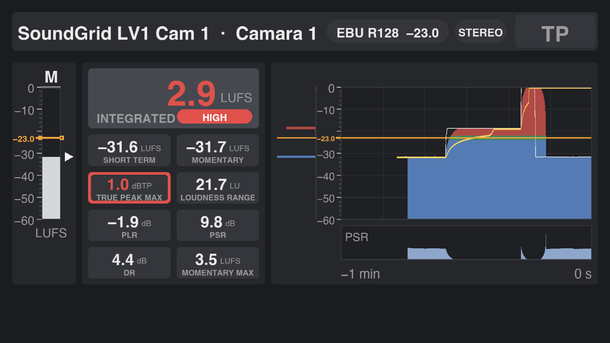

# ADR-017: Medidor de sonoridad (ITU-R BS.1770-4) como segunda vista del monitor

**Estado:** Aceptada · **Fecha:** 2026-11-25

**Contexto:**
- El operador de la consola necesita saber si la emisión cumple un objetivo de sonoridad (EBU R128, ATSC A/85, plataformas de streaming), no solo el nivel de pico. La referencia funcional es Youlean Loudness Meter: momentary, short-term, integrated, true peak, LRA, PLR y DR, con historial y distribución.
- El monitor del Multiview (ADR-016) ya ocupa el recuadro: hay que poder elegir entre los medidores de pico (vista clásica) y los de sonoridad sin perder ninguno.
- Las mediciones deben cumplir BS.1770-4 y no deben tocar el audio ni cargar el hilo de audio.

**Decisión:**
- **Una sola fuente, dos vistas.** `soundgrid_audio_monitor` tiene el ajuste `view` (clásica por defecto, sonoridad). Se cambia en las propiedades, en Herramientas (todos los monitores) o con un atajo de teclado por fuente. Cada vista conserva sus ajustes. Las dos comparten estilo (`src/monitor/MonitorStyle`): cabecera, márgenes, tipografía, colores de superficie y temas oscuro y claro. Los colores funcionales del medidor clásico (verde, amarillo y rojo de OBS) no cambian.
- **Motor en `sg_core`** (`src/monitor/Loudness`), sin libobs y con pruebas:
  - Ponderación K con coeficientes calculados para la frecuencia real (a 48 kHz coinciden con la tabla de la norma). Filtros en doble precisión.
  - Sub-bloques de 100 ms con la energía ponderada por canal (G = 1,0 para L/R/C, 1,41 para envolventes, LFE excluido). Momentary = 4 sub-bloques, short-term = 30.
  - Integrated (puertas −70 LUFS y −10 LU) y LRA (EBU Tech 3342: short-term cada 100 ms, puertas −70 LUFS y −20 LU, P95 − P10) sobre **histogramas de 0,01 LU con la energía exacta** de cada bloque: memoria fija (unos 128 KB) aunque la emisión dure días, y error de clasificación por debajo de 0,01 LU.
  - True peak con un interpolador polifásico (sinc con ventana de Kaiser, 16 coeficientes por fase, ganancia 1 en continua por fase) a ×4 o ×8.
  - PLR = true peak máximo − integrated; PSR = true peak de los últimos 3 s − short-term; DR = media de PSR desde el reinicio. Youlean no publica su DR: este es una aproximación con la misma idea.
- **Captura sin coste para la vista clásica.** Solo con la vista de sonoridad activa, el monitor se registra con `obs_source_add_audio_capture_callback` (la misma vía que los medidores del mezclador de OBS: audio en el formato de OBS, tras los filtros y antes del volumen) o, para la mezcla maestra, con `obs_add_raw_audio_callback` en la pista elegida. El hilo de audio procesa el bloque bajo un candado corto; el hilo de gráficos copia las lecturas y, solo cuando hay un sub-bloque nuevo (10 veces por segundo), el historial.
- **Presets** de objetivo: streaming/música y YouTube (−14 LUFS, −1 dBTP), podcast (−16), EBU R128 (−23, −1 dBTP), ATSC A/85 (−24 LKFS, −2 dBTP), Netflix (−27, −2 dBTP) y personalizado (integrated, tolerancia, true peak y LRA máximo). La zona de la barra, del triángulo, del historial y del estado (BAJO / EN OBJETIVO / ALTO) se calcula con el objetivo y su tolerancia.
- **Estilo de Youlean Loudness Meter 2:** fondos grafito neutros; lecturas en tarjetas redondeadas (valor grande, unidad pequeña y nombre debajo); barra M gris, verde dentro de la tolerancia y roja por encima; objetivo en naranja (corchetes, línea y número de la escala); historial azul → verde → rojo con momentary en blanco; distribución junto al historial. Los textos de color usan el formato de color de OBS (0xBBGGRR, común a `text_ft2_source` y `text_gdiplus`).
- **Dibujo:** columnas del historial y PSR como segmentos agrupados por color en un único vertex buffer dinámico (una llamada a `gs_draw` por color). Esquinas redondeadas con franjas. Colores opacos precalculados (sin mezcla alfa) para que la prueba por píxeles sea determinista.

**Consecuencias:**
- La medición empieza al activar la vista de sonoridad, o al reiniciar. Por defecto no se reinicia al cambiar de escena: en la emisión todas las escenas suelen recibir la misma mezcla de la consola. Se puede activar «Reiniciar al cambiar de fuente».
- La vista de sonoridad puede medir cualquier fuente de audio de OBS o la mezcla maestra. La clásica sigue mostrando solo fuentes SoundGrid, porque depende de `AudioScopeTap`.
- No implementado: dialogue gating (Netflix lo usa, así que su preset es orientativo), configuración de canales personalizada, exportación de informes y análisis de archivos (fase 3 del requisito).
- El Multiview no recibe clics: el reinicio se hace desde las propiedades, Herramientas o un atajo.
