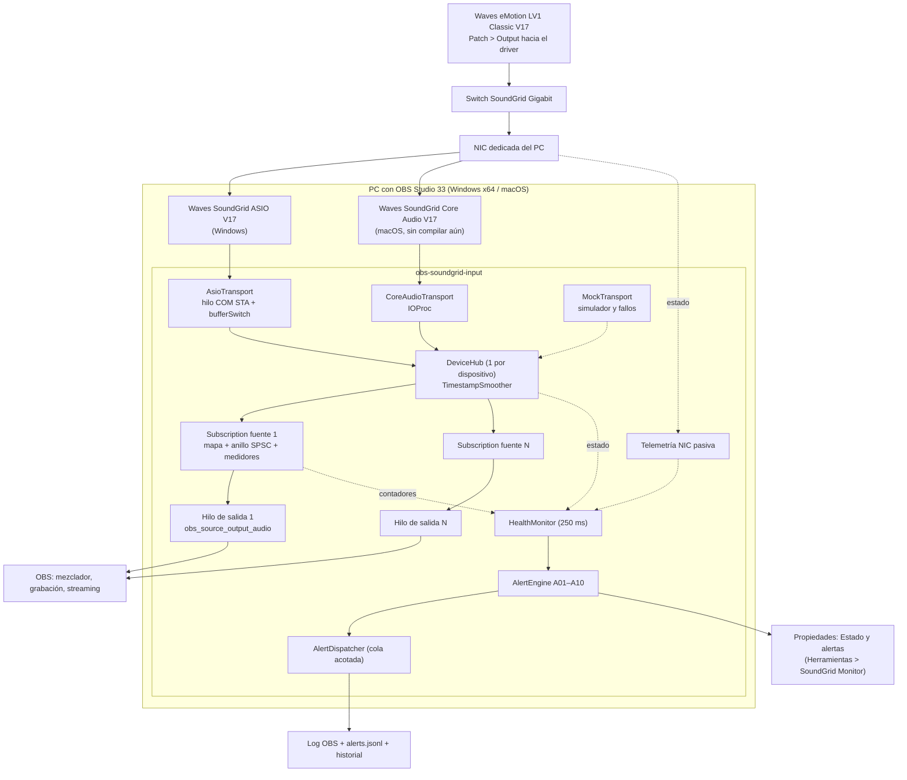

# Arquitectura implementada (v0.1.0)

Este documento describe el código **tal como está**. Los diagramas objetivo originales están en `../diagramas/`; el `05_arquitectura_windows_macos` sigue siendo la referencia de alto nivel.

## 1. Despliegue y flujo de audio

No hay ruta B (SoundGrid nativo): está `BLOQUEADO POR PROTOCOLO` ([NATIVE_FEASIBILITY.md](NATIVE_FEASIBILITY.md)).

## 2. Módulos

| Módulo | Ruta | Responsabilidad |
|---|---|---|
| Tipos y reloj | `src/common` | `IClock` (monotónico, inyectable), `Observed<T>` (valor + procedencia), ajustes versionados |
| Audio | `src/audio` | `SpscQueue`, `PcmBlockRing`, `SampleConvert` (int16/24/32, float32/64, LE/BE), `ChannelMap`, `MeterBank`, `TimestampSmoother` |
| Transporte | `src/transport` | `IAudioTransport`, `MockTransport`, `DeviceHub`, `TransportManager` |
| Plataforma | `src/platform` | `AsioTransport` y `WindowsNicTelemetry` (Windows); `CoreAudioTransport` y `MacNicTelemetry` (macOS) |
| Observabilidad | `src/observability` | `HealthSnapshot`, `AlertEngine`, `AlertDispatcher`, `JsonlAlertLog`, `AlertHistory` |
| Sesión | `src/core` | `SourceSession` (una por fuente OBS), `HealthMonitor`, `CoreRuntime` |
| OBS | `src/obs` | Registro del módulo, fuente `soundgrid_input`, propiedades, diagnóstico. Única capa que incluye libobs |

## 3. Interfaces y contratos

| Interfaz | Propietario de los datos | Hilos |
|---|---|---|
| `IAudioTransport` | Adaptador | `open/start/stop/close/snapshot/takeEvents` en el hilo de control; `ICaptureSink::onCapture` en tiempo real; `stop()` no vuelve hasta que no hay más callbacks |
| `Subscription` | `DeviceHub` | Productor: callback (RT). Consumidor: hilo de salida. Mapa con doble buffer y barrera de callback |
| `HealthSnapshot` | `SourceSession` | Lo construye el monitor a partir de atómicos; inmutable una vez creado |
| `AlertEvent` | `AlertEngine` | Evaluación en el hilo del monitor; publicación sin bloqueo a la cola acotada |
| `IChannelCatalog` | `IAudioTransport::channels()` | Nombres = puertos del driver (`ChannelNameSource::DriverPort`). No hay nombres de la LV1 |
| `INetworkTelemetry` | Plataforma | Lectura pasiva con caché de 200 ms; `nullopt` significa NO DISPONIBLE |

## 4. Hilos y garantías de tiempo real

| Hilo | Hace | Nunca hace |
|---|---|---|
| Callback del driver (ASIO `bufferSwitch` / IOProc) | Convertir a float32, mapear canales, escribir en anillos preasignados, medir Peak/RMS, contadores atómicos, `atomic::notify_one` | Asignar memoria (T48: 0 asignaciones), locks, logs, E/S, UI |
| Hilo COM de ASIO | Todas las llamadas de control al driver, con bomba de mensajes | Procesar audio |
| Hilo de salida (uno por fuente) | `obs_source_output_audio` y medir la latencia callback→entrega | Llamar al driver |
| Control (`TransportManager`, 50 ms) | Abrir y cerrar, eventos del driver, reconexión con backoff, detección de bloqueo | Tocar la consola |
| Monitor (250 ms) | Instantáneas, reglas A01–A10, NIC con caché | Bloquear el callback |
| Despachador de alertas | JSONL rotativo, log de OBS, historial | Crecer sin límite (cola de 1024 y descartes contados) |
| UI de OBS | Propiedades y acciones | Leer PCM |

## 5. Estados mostrados al operador

Nunca se muestra un único "Conectado": hay seis indicadores independientes (`ConnectivityIndicators`).

| Indicador | Fuente de evidencia | Qué NO demuestra |
|---|---|---|
| Red (NIC): UP/DOWN/velocidad | API del SO | Que haya una LV1 o audio |
| Driver: DISCOVERED/STREAMING/ERROR | Estado del transporte | Que el patch sea correcto |
| Audio: recibiendo PCM, nivel | Frames y RMS de la fuente | Que no haya un corte después |
| Patch LV1 | "No verificado" | Solo cambia con HIL o una API autorizada (no existe) |
| Consola LV1 | "No identificada (no existe API autorizada)" | |
| Latencia | Plugin (medido), driver (informado), extremo a extremo (NO DISPONIBLE) | |

## 6. Correlación de incidentes
- `A04 NIC DOWN` domina a A02, A03, A05 y A06. `A03 driver perdido` domina a A02.
- Si la causa raíz está pendiente de su *debounce*, las consecuencias esperan y se abren ya correlacionadas.
- Si la causa raíz se detecta después, se reclasifican (`CORRELATED`).
- Resultado (T38, T51, T44 simulado): un único incidente notificado por fallo físico.

## 7. Cumplimiento de la regla de actualización
Toda modificación que cambie transporte, flujo de audio, hilos o alertas debe actualizar este documento, los ADR y las pruebas en el mismo cambio.
