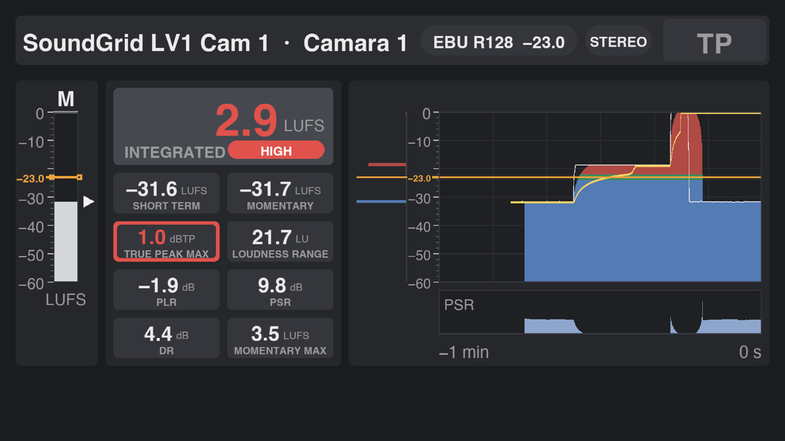
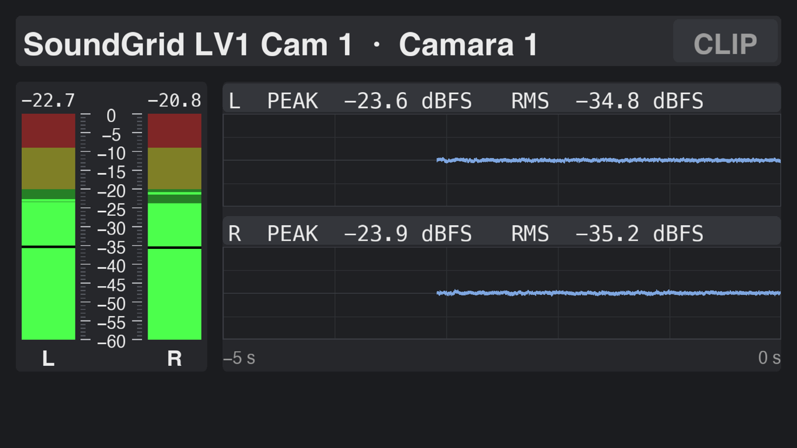
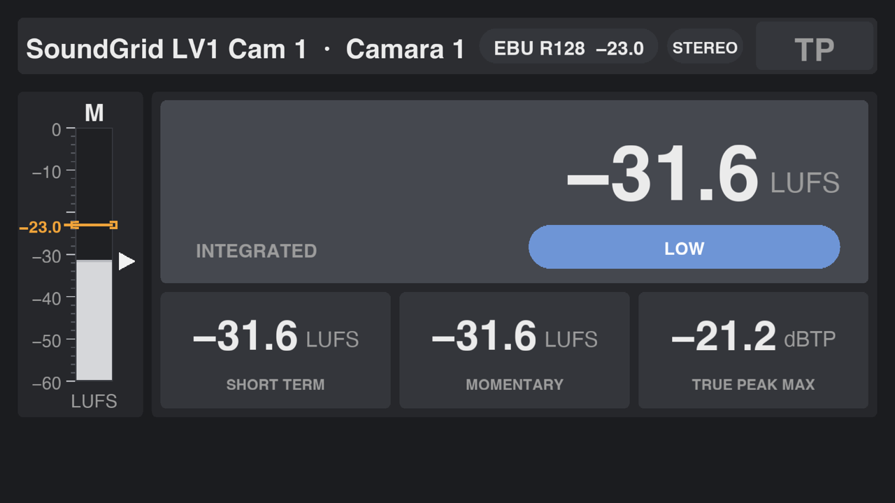
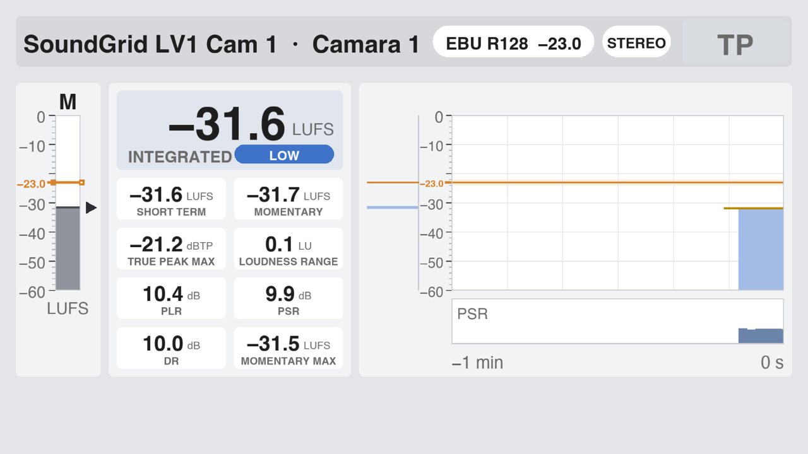

# Monitor de audio en el Multiview

Para el operador de la consola que ve el Multiview de OBS en otra pantalla: muestra el audio de la escena que el director tiene al aire, en el recuadro inferior derecho del Multiview.

Tiene **dos vistas** con el mismo estilo, y se cambia de una a otra sin perder la configuración:

| Vista | Para qué |
|---|---|
| **Sonoridad (LUFS)** | Medidor de sonoridad según ITU-R BS.1770-4, al estilo de Youlean Loudness Meter: momentary, short-term, integrated, true peak, LRA, PLR, PSR y DR, con historial, distribución y objetivo (EBU R128, ATSC A/85, streaming…). |
| **Clásica** | Medidores L/R en dBFS con peak hold, osciloscopio, Peak/RMS y aviso de clip. Es la vista por defecto. |

## Cambiar de vista

- En las propiedades del monitor: **Vista > Sonoridad (LUFS) / Clásica**.
- **Herramientas > SoundGrid: cambiar vista del monitor de audio** cambia todos los monitores de la colección.
- Con un atajo de teclado: **Ajustes > Atajos >** «Monitor de audio SoundGrid (Multiview)» **> SoundGrid: cambiar vista del monitor de audio**.

Las dos vistas comparten el estilo (cabecera, paneles redondeados, tarjetas para las lecturas, tema oscuro o claro y tamaño del texto). En la vista clásica, los medidores conservan el verde, amarillo y rojo de OBS; la forma de onda usa el azul del tema. Al volver a una vista se conserva su configuración.

## Vista de sonoridad (LUFS)

Mide según **ITU-R BS.1770-4** y **EBU Tech 3341/3342**. Solo mide: no modifica, normaliza ni limita el audio.

| Medida | Unidad | Definición |
|---|---|---|
| Momentary | LUFS | Sonoridad de los últimos 400 ms. Es la barra vertical. |
| Short-term | LUFS | Sonoridad de los últimos 3 s. Es el triángulo junto a la barra y el área del historial. |
| Integrated | LUFS | Sonoridad de todo el audio desde el último reinicio, con la puerta absoluta (−70 LUFS) y la relativa (−10 LU). Es el valor grande. Muestra «—» hasta que hay audio por encima de −70 LUFS. |
| True peak | dBTP | Pico real con sobremuestreo ×4 (u ×8): incluye los picos entre muestras. Se muestra el máximo desde el reinicio. |
| LRA | LU | Loudness range (EBU Tech 3342): diferencia entre los percentiles 95 y 10 del short-term, con puertas −70 LUFS y −20 LU. |
| PLR | dB | True peak máximo − integrated. |
| PSR | dB | True peak de los últimos 3 s − short-term. |
| DR | dB | Media de PSR (cada 100 ms, con short-term por encima de −70 LUFS) desde el reinicio. Youlean no publica su algoritmo de DR: este es una aproximación basada en la misma idea. |

LUFS y LKFS son la misma unidad: la etiqueta puede ser una u otra (en ATSC A/85 sale LKFS por defecto).

### Qué se ve

| Elemento | Detalle |
|---|---|
El estilo sigue a Youlean Loudness Meter 2: fondos grafito, lecturas en tarjetas y el objetivo en naranja.

| Elemento | Detalle |
|---|---|
| Cabecera | Fuente y escena; píldoras con el objetivo (p. ej. «EBU R128 −23.0») y los canales («STEREO», «MIX 1»…); distintivo **TP**. |
| Barra **M** | Momentary de −60 a 0 LUFS con la escala a la izquierda. **Gris** por debajo del objetivo, **verde** dentro de la tolerancia y **roja** por encima. Los corchetes y la línea naranjas marcan el objetivo y su tolerancia; el número del objetivo sale en naranja en la escala. La marca gris es el máximo de momentary. |
| Triángulo | Short-term, en blanco, junto a la barra. |
| Tarjetas | **Integrated** grande, en rojo por encima del objetivo y en verde dentro, con **BAJO / EN OBJETIVO / ALTO**. Debajo, ocho tarjetas: short term, momentary, true peak máx., loudness range, PLR, PSR, DR y momentary máx. Se actualizan 10, 20, 30 o 60 veces por segundo. |
| Distribución | A la izquierda del historial: cuánto tiempo estuvo el short-term en cada LU, en azul por debajo del objetivo y en rojo por encima. |
| Historial | Área de short-term azul que pasa a verde dentro de la tolerancia y a roja por encima; línea blanca de momentary y amarilla de integrated; objetivo en naranja. De 30 s a 60 min. |
| Dinámica (opcional) | PSR bajo el historial, de 0 a 30 dB. |
| Alerta de true peak | Si el true peak supera el umbral (p. ej. −1 dBTP), la tarjeta TRUE PEAK MAX se enmarca en rojo y su valor sale en rojo hasta el reinicio; el distintivo **TP** de la cabecera parpadea mientras el exceso sea reciente (últimos 3 s). |
| LRA | Con un LRA máximo (objetivo personalizado), su valor sale en rojo si lo supera. |
| Modo compacto | Barra, integrated grande y tres tarjetas (short term, momentary y true peak): para usar el monitor en una escena como overlay. |

| Modo compacto | Tema claro |
|---|---|
|  |  |

### Objetivos (presets)

| Objetivo | Integrated | Tolerancia | True peak máx. |
|---|---|---|---|
| Streaming / música | −14 LUFS | ±1 LU | −1 dBTP |
| YouTube | −14 LUFS | ±1 LU | −1 dBTP |
| Podcast | −16 LUFS | ±1 LU | −1 dBTP |
| EBU R128 (TV europea) | −23 LUFS | ±1 LU | −1 dBTP |
| ATSC A/85 (TV de EE. UU.) | −24 LKFS | ±2 LU | −2 dBTP |
| Netflix | −27 LUFS | ±2 LU | −2 dBTP |
| Personalizado | El que elijas (−40 a −5) | 0,5 a 5 LU | −6 a 0 dBTP, y LRA máximo opcional |

Netflix mide la sonoridad del diálogo (dialogue gating); este medidor mide el programa completo, así que su valor es orientativo.

### Configuración de la sonoridad

| Ajuste | Opciones |
|---|---|
| Medir la fuente de | La SoundGrid de la escena de programa o de la vista previa, una fuente fija (SoundGrid u otra fuente de audio de OBS) o la **mezcla maestra** (pista 1 a 6). |
| Canales | Automático (los de la salida de audio de OBS), mono, estéreo o 5.1. El LFE no cuenta y los envolventes pesan 1,41, como dice la norma. |
| Unidades | Según el objetivo, LUFS o LKFS. |
| Actualización de las lecturas | 10, 20, 30 o 60 Hz. Las gráficas se dibujan en cada fotograma. |
| Historial | 30 s, 1, 2, 5, 10, 30 o 60 min. |
| Sobremuestreo del true peak | 4x u 8x. |
| Diseño | Completo o compacto. |
| Reiniciar al cambiar de fuente | Desactivado por defecto: en la emisión todas las escenas suelen recibir la misma mezcla de la consola. |

**Reiniciar la medición** (integrated, LRA, máximos e historial): botón en las propiedades, **Herramientas > SoundGrid: reiniciar la medición de sonoridad** o un atajo de teclado.

La vista de sonoridad recibe el audio como los medidores del mezclador de OBS, después de los filtros de la fuente y antes de su volumen. Con la mezcla maestra mide lo que sale por la pista elegida. Solo escucha mientras esta vista está activa.

## Vista clásica

### Qué muestra

| Elemento | Detalle |
|---|---|
| Etiqueta | Nombre de la fuente SoundGrid y de la escena al aire. `(+N)` si la escena tiene más fuentes SoundGrid visibles; `mono` si la fuente es mono (se ve igual en L y R). |
| Cabecera | Gris: hay audio. **Roja «SIN SEÑAL»**: no llega audio desde hace más de 0,5 s, la escena no tiene fuente SoundGrid o la fuente no existe. **Ámbar «SILENCIADA EN OBS»**: llega audio, pero la fuente está silenciada en el mezclador de OBS. |
| Medidores L y R | Como el medidor de volumen de OBS: verde hasta −20 dBFS, amarillo hasta −9 dBFS y rojo por encima. Escala de 0 a −60 dBFS. La barra cae 11,76 dB/s; la marca negra es el RMS. |
| Peak hold | Línea sobre cada barra y valor en dBFS encima. Se mantiene 20 s o hasta un pico mayor. |
| Osciloscopio | L arriba y R abajo. Lo más reciente está a la derecha y la onda avanza hacia la izquierda en tiempo real. Por defecto muestra 5 s (de 1 a 30), con una línea vertical por segundo. Las líneas horizontales marcan ±50 % (−6 dBFS). Si deja de llegar audio, la parte derecha queda vacía. |
| Peak / RMS | Sobre cada canal del osciloscopio: pico y RMS de los últimos 300 ms en dBFS. Se actualizan 5 veces por segundo. |
| Clip | El recuadro **CLIP** y un marco rojo en el medidor se encienden cuando una muestra llega a −0,1 dBFS (el mismo umbral que la alerta A09). Siguen encendidos 5 s. La onda saturada se dibuja en rojo. |

El audio es el que el plugin entrega a OBS, antes de los filtros y del volumen del mezclador de OBS, es decir, lo que manda la consola. La vista clásica solo muestra fuentes SoundGrid.

## Configuración

No hace falta crear ninguna escena. **Al abrir OBS** (y al cambiar de colección de escenas), el plugin crea la escena «Monitor de audio SoundGrid» si falta, con el monitor dentro. Basta con abrir el Multiview (**Vista > Abrir vista múltiple**). El log de OBS indica en qué recuadro queda.

1. Opcional: para que quede en el último recuadro, arrastra la escena a la posición que indica **Herramientas > SoundGrid: monitor de audio en el Multiview** (o el botón **Colocar en el Multiview…** de la fuente), según el diseño de Multiview (Ajustes > General > Multiview) y las escenas ocultas. Con el diseño por defecto, «Horizontal, arriba (8 escenas)», es la 8.ª escena visible.
2. En las propiedades de la fuente «Monitor de audio SoundGrid (Multiview)» puedes elegir:
   - **Vista:** clásica (por defecto) o sonoridad.
   - **Medir la fuente de:** la escena de programa (por defecto), la vista previa (modo estudio), una fuente fija o la mezcla maestra (solo en la vista de sonoridad).
   - **Segundos de forma de onda** (vista clásica).
   - **Sonoridad:** objetivo y el resto de ajustes de la vista de sonoridad.
   - **Tema** (oscuro o claro) y **tamaño del texto** (50–200 %), para las dos vistas.
   - **Crear esta escena al abrir OBS (en todo OBS)**, activado por defecto. Si lo desactivas y borras la escena, no se vuelve a crear.

En cada escena se usa la fuente SoundGrid visible que esté más arriba en la lista de fuentes, incluidas las que están dentro de grupos o de escenas anidadas.

## Avisos

- La escena del monitor aparece en la lista de escenas del director. Si alguien la pulsa (también desde el Multiview), el plugin vuelve inmediatamente a la escena anterior en programa y en vista previa, y lo registra en el log. Para evitar incluso ese cambio breve, desactiva en el ordenador del Multiview la opción de cambiar de escena con un clic (Ajustes > General > Multiview).
- Esa protección solo se aplica a la escena que creó el plugin (lleva una marca interna). Si añades la fuente del monitor a una escena tuya, esa escena puede salir al aire con normalidad.
- La escena que antes ocupaba el último recuadro deja de verse en el Multiview.
- Si hay menos escenas que recuadros, el monitor queda en el primer recuadro libre, no en la esquina. Elige un diseño de Multiview con menos recuadros.
- En los diseños «Horizontal, abajo» y «Vertical, derecha», el último recuadro de escena no es la esquina inferior derecha.

Decisiones de diseño: [ADR-016](ADR/ADR-016-monitor-multiview.md) (monitor como escena propia) y [ADR-017](ADR/ADR-017-medidor-sonoridad.md) (medidor de sonoridad).
