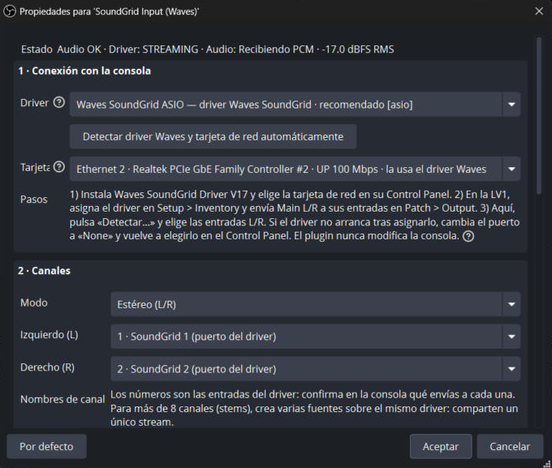

# Instalación y primera configuración

Esta guía es para quien solo quiere **descargar e instalar** el plugin. Tiene una parte para cada sistema:

- **Windows** (probado con la LV1): las secciones 1 a 8 de abajo.
- **[macOS](#macos)** (experimental, sin probar con hardware Waves): la sección del final.

Para compilarlo desde el código, ver el README: [Windows](../README.md#compilar-desde-el-código-windows) o [macOS](../README.md#compilar-desde-el-código-macos).

## 1. Antes de empezar

| Necesitas | Detalle |
|---|---|
| Windows 10 u 11 de 64 bits | Con una cuenta que pueda aceptar el aviso de administrador (UAC) |
| OBS Studio 33.x de 64 bits | Probado con 33.0.1. Descárgalo de [obsproject.com](https://obsproject.com) si no lo tienes |
| Waves SoundGrid Driver V17 | Se instala con **Waves Central** (requiere cuenta de Waves). Probado con 17.3.37.122 |
| Conexión con la consola | Cable Cat5e/Cat6 desde una tarjeta de red **Gigabit** del PC a un puerto SoundGrid de la LV1 o a su switch |

El instalador de este plugin **no incluye** el driver de Waves ni modifica OBS.

## 2. Descargar

1. Abre **[Releases](https://github.com/japalacioo/obs-soundgrid-input/releases/latest)**.
2. En **Assets**, descarga:
   - `obs-soundgrid-input-<versión>-windows-x64-setup.exe` (el instalador).
   - Opcional: `obs-soundgrid-input-<versión>-windows-x64-setup.exe.sha256`, para comprobar que el archivo llegó íntegro.

### Comprobar el archivo (opcional)

En PowerShell, en la carpeta de descargas:

```bash
powershell -Command "(Get-FileHash .\obs-soundgrid-input-0.4.0-windows-x64-setup.exe -Algorithm SHA256).Hash"
```

El resultado debe coincidir (sin distinguir mayúsculas) con el texto del archivo `.sha256` y con el que aparece en la página de la versión.

## 3. Instalar

1. **Cierra OBS.** Si está abierto, el instalador avisa y espera a que lo cierres.
2. Ejecuta el instalador con doble clic.
3. **SmartScreen:** el instalador no tiene firma digital, así que Windows puede mostrar "Windows protegió su PC". Pulsa **Más información > Ejecutar de todas formas**.
4. Acepta el aviso de **Control de cuentas de usuario** (instala para todos los usuarios del equipo).
5. Sigue el asistente en español o inglés. Al final indica si encontró el driver Waves SoundGrid.

Se instala en `%ProgramData%\obs-studio\plugins\obs-soundgrid-input\` (la carpeta de plugins de OBS 33). En el menú Inicio quedan accesos a esta guía, a la solución de problemas, a las alertas y al desinstalador.

## 4. Configurar Waves y la consola (se hace fuera del plugin)

1. Instala el **SoundGrid Driver V17** con Waves Central y reinicia el PC.
2. Conecta el PC a la red SoundGrid y comprueba que la tarjeta enlaza a **1 Gbps** (Configuración de Windows > Red). Si se queda en 100 Mbps, cambia el cable.
3. En el **SoundGrid Driver Control Panel**, elige esa tarjeta de red.
4. En la LV1, en **Setup > Inventory**, asigna el driver de este PC. **Hazlo fuera de show y con el responsable de sonido.**
5. En la LV1, en **Patch > Output**, envía Main L/R (o el bus que quieras) a las entradas 1 y 2 del driver.
6. Si el driver no transmite tras asignarlo: en el Control Panel, cambia el puerto a **None** y vuelve a elegir la tarjeta. El servicio de Waves no reintenta solo.

## 5. Usar el plugin en OBS

**Sin hacer nada más**, al abrir OBS el plugin:
- abre el SoundGrid Driver Control Panel (minimizado) y lo reabre si se cierra;
- escucha el driver Waves (entradas 1–2) y muestra una **barra roja arriba** si se pierde el audio, se cae el driver, se desconecta el cable o hay silencio prolongado.

Su estado está en **Herramientas > SoundGrid Monitor**:


**Para llevar el audio de la consola a OBS** (grabación o transmisión), añade una fuente:
1. **Fuentes > + > SoundGrid Input (Waves)**.
2. La fuente se configura sola con el driver Waves, la tarjeta de red de su Control Panel y las entradas 1–2. Si no, pulsa **Detectar driver Waves y tarjeta de red automáticamente**.
3. En **2 · Canales**, elige el modo (estéreo, mono o multicanal) y las entradas del driver.
4. En **3 · Avisos y alertas**, deja activado el aviso rojo. Activa "silencio prolongado" solo si esa fuente debe tener señal continua.
5. Arriba del panel, el **Estado** debe decir "Audio OK · Driver: STREAMING · Audio: Recibiendo PCM" con nivel.




Cuando hay una fuente visible con el driver Waves, la vigilancia global se pausa para no avisar dos veces.

### Monitor de audio en el Multiview

Al abrir OBS, el plugin crea la escena **«Monitor de audio SoundGrid»** si no existe. Abre el Multiview (**Vista > Abrir vista múltiple**) y el monitor aparece en un recuadro de escena, con los medidores L/R, la forma de onda y el nombre de la fuente SoundGrid de la escena al aire. No hay que crear ni configurar nada.

- Para que quede en el último recuadro (abajo a la derecha), arrastra la escena al final de la lista; con menos escenas que recuadros queda en el primer recuadro libre.
- Esa escena nunca sale al aire: si alguien la pulsa, el plugin vuelve a la escena anterior. Las escenas del director que contengan el monitor no se tocan.
- Para que no se cree, desactiva **Crear esta escena al abrir OBS** en las propiedades de la fuente del monitor y borra la escena.

Detalle en [AUDIO_MONITOR.md](AUDIO_MONITOR.md).

### Qué significa cada color de la barra

| Color | Mensaje | Qué hacer |
|---|---|---|
| Rojo | **SE PERDIÓ EL AUDIO** · fuente · causa · hora | Revisa la causa indicada (cable, driver, patch o señal). Clic en la barra para ver el panel |
| Ámbar | **AUDIO RESTABLECIDO, VERIFICANDO** | El audio volvió; se confirma durante 5 s |
| Verde | **AUDIO RECUPERADO** | Todo bien; desaparece a los 5 s |

Más detalle en [ALERTS.md](ALERTS.md).

## 6. Actualizar a una versión nueva

Descarga el instalador nuevo, cierra OBS y ejecútalo: sustituye la versión anterior. Tus escenas, fuentes y ajustes se conservan.

## 7. Desinstalar

**Configuración de Windows > Aplicaciones > OBS SoundGrid Input > Desinstalar** (o el acceso del menú Inicio). Cierra OBS antes.

Se conservan tus escenas y la carpeta de configuración del plugin: `%APPDATA%\obs-studio\plugin_config\obs-soundgrid-input` (alertas, diagnóstico y ajustes). Bórrala a mano si no la quieres.

## 8. Instalación desatendida (varios equipos)

```bash
obs-soundgrid-input-0.4.0-windows-x64-setup.exe /VERYSILENT /SUPPRESSMSGBOXES /NORESTART
```

Devuelve 0 si se instaló. Si OBS está abierto, no instala y devuelve un código distinto de 0. Necesita una consola con permisos de administrador.

## Alternativa: ZIP sin instalador

En Releases también está `obs-soundgrid-input-<versión>-windows-x64.zip`:
1. Cierra OBS y descomprime el ZIP.
2. Clic derecho en `install.ps1` > **Ejecutar con PowerShell** (o `powershell -ExecutionPolicy Bypass -File install.ps1`).
3. Para quitarlo, ejecuta `uninstall.ps1`.

No registra desinstalador en Aplicaciones. Si ya instalaste con el `.exe`, usa el `.exe` también para actualizar.

## macOS

**Experimental.** El plugin es un binario universal (Apple Silicon e Intel). Carga en OBS 33.0.2 en macOS 26 (Apple Silicon) y el monitor del Multiview funciona con el simulador, pero **no se ha probado con hardware Waves en Mac**. En Intel no se ha ejecutado. Ver [LIMITATIONS.md](LIMITATIONS.md).

Diferencias con Windows:

| | Windows | macOS |
|---|---|---|
| Driver de Waves | ASIO | Core Audio |
| Barra roja de aviso en OBS | Sí | **No todavía**: las alertas salen en el panel de la fuente, en el log de OBS y en `alerts.jsonl` |
| Herramientas > SoundGrid Monitor | Ventana con el estado | Escribe el estado en el log de OBS |
| Abrir y mantener abierto el Control Panel de Waves | Sí | No: ábrelo tú |
| Tarjeta de red del Control Panel de Waves | Se detecta sola | Elígela a mano en la fuente |
| Vigilancia global sin fuentes y monitor del Multiview | Sí | Sí |

### 1. Antes de empezar

| Necesitas | Detalle |
|---|---|
| macOS 11 o posterior | Waves pide **macOS 14 Sonoma o posterior** para el SoundGrid Driver V17. Probado en macOS 26 |
| OBS Studio 30 o posterior | Probado con 33.0.2. Descárgalo de [obsproject.com](https://obsproject.com) |
| Waves SoundGrid Driver V17 para Mac | Se instala con **Waves Central** (requiere cuenta de Waves). Sin probar con este plugin |
| Conexión con la consola | Cable Cat5e/Cat6 desde un puerto Ethernet **Gigabit** del Mac (o un adaptador USB-C; Waves recomienda el chipset ASIX AX88179A) a un puerto SoundGrid de la LV1 o a su switch |

El instalador **no incluye** el driver de Waves ni modifica OBS.

### 2. Descargar

1. Abre **[Releases](https://github.com/japalacioo/obs-soundgrid-input/releases/latest)**.
2. En **Assets**, descarga:
   - `obs-soundgrid-input-<versión>-macos-universal.pkg` (el instalador).
   - Opcional: `obs-soundgrid-input-<versión>-macos-universal.pkg.sha256`, para comprobar que el archivo llegó íntegro.

#### Comprobar el archivo (opcional)

En Terminal, en la carpeta de descargas:

```bash
shasum -a 256 obs-soundgrid-input-0.4.0-macos-universal.pkg
```

El resultado debe coincidir con el texto del archivo `.sha256`. Para la 0.4.0 es `9049b53abcf86b0b80a66f5cb0566add10beafb8f51dd5a4b358694619375a4f`.

### 3. Instalar

1. **Cierra OBS.**
2. Abre el `.pkg` con doble clic.
3. **Gatekeeper:** el instalador no está firmado ni notarizado, así que macOS puede decir que no puede verificar el desarrollador. Ve a **Ajustes del Sistema > Privacidad y seguridad**, pulsa **Abrir igualmente** y vuelve a abrir el `.pkg`.
4. Sigue el asistente. Se instala **solo para tu usuario** y no pide contraseña.

Se instala en `~/Library/Application Support/obs-studio/plugins/obs-soundgrid-input.plugin` (OBS 30+ carga los plugins `.plugin` de esa carpeta).

5. Abre OBS. La primera vez, macOS pide permiso de **micrófono** para OBS: acéptalo. Sin él, Core Audio no entrega audio. Si lo rechazaste, actívalo en **Ajustes del Sistema > Privacidad y seguridad > Micrófono > OBS**.
6. En **Ayuda > Archivos de registro > Ver archivo de registro actual** debe aparecer `OBS SoundGrid Input 0.4.0`.

### 4. Configurar Waves y la consola (se hace fuera del plugin)

Los pasos son los mismos que en Windows. No se han probado en Mac con este plugin.

1. Instala el **SoundGrid Driver V17** con Waves Central y reinicia el Mac.
2. Conecta el Mac a la red SoundGrid y comprueba que el puerto enlaza a **1 Gbps** (**Ajustes del Sistema > Red >** el puerto Ethernet **> Detalles > Hardware**). Si se queda en 100 Mbps, cambia el cable.
3. En el **SoundGrid Driver Control Panel**, elige ese puerto de red.
4. En la LV1, en **Setup > Inventory**, asigna el driver de este Mac. **Hazlo fuera de show y con el responsable de sonido.**
5. En la LV1, en **Patch > Output**, envía Main L/R (o el bus que quieras) a las entradas 1 y 2 del driver.

Waves desaconseja grabar en Apple Silicon (cortes intermitentes) y pasar más de 32 canales por el Ethernet integrado del Mac.

### 5. Usar el plugin en OBS

**Sin hacer nada más**, al abrir OBS el plugin escucha el primer dispositivo Core Audio con "SoundGrid" o "Waves" en el nombre (entradas 1–2) y revisa cada 5 s si aparece o desaparece. Si se pierde el audio, la alerta queda en el log de OBS (líneas `[soundgrid]`) y en `alerts.jsonl`; **no hay barra roja en macOS**.

**Para llevar el audio de la consola a OBS**, añade una fuente:
1. **Fuentes > + > SoundGrid Input (Waves)**.
2. En **1 · Conexión**, elige el dispositivo Waves SoundGrid y, en **Tarjeta de red**, el puerto que usa su Control Panel. En Mac no se marca solo: elígelo a mano.
3. En **2 · Canales**, elige el modo (estéreo, mono o multicanal) y las entradas del driver.
4. En **3 · Avisos y alertas**, activa "silencio prolongado" solo si esa fuente debe tener señal continua. El perfil (Ensayo, Transmisión o Grabación) está en los ajustes avanzados.
5. Arriba del panel, el **Estado** debe decir "Audio OK · Driver: STREAMING · Audio: Recibiendo PCM" con nivel. Pulsa **Actualizar estado** para refrescarlo.

Sin hardware Waves, elige el dispositivo marcado **«simulador, NO es Waves»** para probar canales, stems y el monitor.

El **monitor de audio en el Multiview** funciona igual que en Windows: la escena «Monitor de audio SoundGrid» se crea sola al abrir OBS (en un OBS en inglés se llama «SoundGrid Audio Monitor»). Ver [Monitor de audio en el Multiview](#monitor-de-audio-en-el-multiview) y [AUDIO_MONITOR.md](AUDIO_MONITOR.md).

### 6. Actualizar a una versión nueva

Cierra OBS y abre el `.pkg` nuevo: sustituye la versión anterior. Tus escenas, fuentes y ajustes se conservan.

### 7. Desinstalar

No hay desinstalador. Cierra OBS y borra la carpeta del plugin:

```bash
rm -rf ~/Library/Application\ Support/obs-studio/plugins/obs-soundgrid-input.plugin
```

Se conserva la configuración del plugin en `~/Library/Application Support/obs-studio/plugin_config/obs-soundgrid-input` (alertas, diagnóstico y ajustes). Bórrala a mano si no la quieres.

### 8. Instalación desatendida (varios equipos)

Con OBS cerrado, en la sesión del usuario que usa OBS (sin `sudo`):

```bash
installer -pkg obs-soundgrid-input-0.4.0-macos-universal.pkg -target CurrentUserHomeDirectory
```

### Alternativa: ZIP sin instalador

En Releases también está `obs-soundgrid-input-<versión>-macos-universal.zip`, con la carpeta `obs-soundgrid-input.plugin`:
1. Cierra OBS y descomprime el ZIP.
2. Mueve `obs-soundgrid-input.plugin` a `~/Library/Application Support/obs-studio/plugins/` (crea la carpeta `plugins` si no existe).
3. Si OBS no carga el plugin, quita la marca de descarga de macOS:

```bash
xattr -dr com.apple.quarantine ~/Library/Application\ Support/obs-studio/plugins/obs-soundgrid-input.plugin
```

Para quitarlo, borra esa carpeta.

## Dónde están los registros

- Log de OBS: **Ayuda > Archivos de registro**. Las líneas del plugin empiezan por `[soundgrid]`.
- Alertas: `%APPDATA%\obs-studio\plugin_config\obs-soundgrid-input\alerts.jsonl` (macOS: `~/Library/Application Support/obs-studio/plugin_config/obs-soundgrid-input/alerts.jsonl`).
- Diagnóstico: botón **Exportar diagnóstico** del panel; queda en `diagnostics.json`, en la misma carpeta que `alerts.jsonl`. No contienen IP ni MAC.

Si algo no funciona, consulta [TROUBLESHOOTING.md](TROUBLESHOOTING.md).
