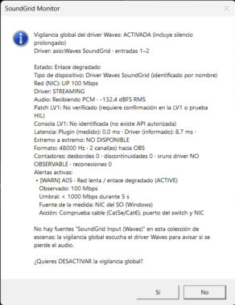
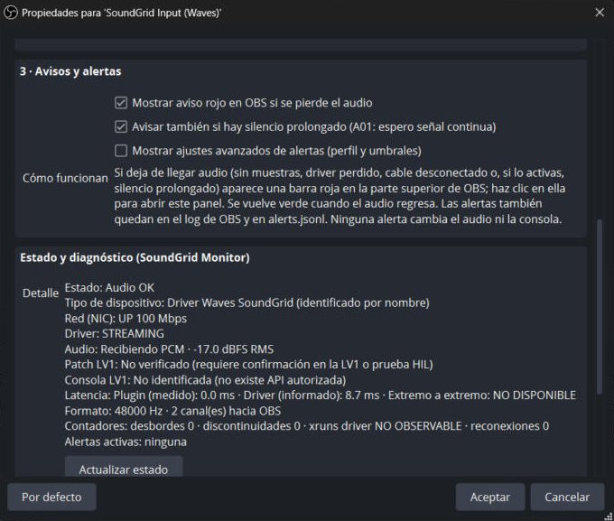

# Instalación y primera configuración

Esta guía es para quien solo quiere **descargar e instalar** el plugin en Windows. Para compilarlo desde el código, ver el [README](../README.md#compilar-desde-el-código-windows).

## 1. Antes de empezar

| Necesitas | Detalle |
|---|---|
| Windows 10 u 11 de 64 bits | Con una cuenta que pueda aceptar el aviso de administrador (UAC) |
| OBS Studio 33.x de 64 bits | Probado con 33.0.1. Descárgalo de [obsproject.com](https://obsproject.com) si no lo tienes |
| Waves SoundGrid Driver V17 | Se instala con **Waves Central** (requiere cuenta de Waves). Probado con 17.3.37.122 |
| Conexión con la consola | Cable Cat5e/Cat6 desde una tarjeta de red **Gigabit** del PC a un puerto SoundGrid de la LV1 o a su switch |

El instalador de este plugin **no incluye** el driver de Waves ni modifica OBS.

## 2. Descargar

1. Abre **[Releases](https://github.com/japalacioo/obs-soundgrid-input/releases/latest)**.
2. En **Assets**, descarga:
   - `obs-soundgrid-input-<versión>-windows-x64-setup.exe` (el instalador).
   - Opcional: `obs-soundgrid-input-<versión>-windows-x64-setup.exe.sha256`, para comprobar que el archivo llegó íntegro.

### Comprobar el archivo (opcional)

En PowerShell, en la carpeta de descargas:

```bash
powershell -Command "(Get-FileHash .\obs-soundgrid-input-0.4.0-windows-x64-setup.exe -Algorithm SHA256).Hash"
```

El resultado debe coincidir (sin distinguir mayúsculas) con el texto del archivo `.sha256` y con el que aparece en la página de la versión.

## 3. Instalar

1. **Cierra OBS.** Si está abierto, el instalador avisa y espera a que lo cierres.
2. Ejecuta el instalador con doble clic.
3. **SmartScreen:** el instalador no tiene firma digital, así que Windows puede mostrar "Windows protegió su PC". Pulsa **Más información > Ejecutar de todas formas**.
4. Acepta el aviso de **Control de cuentas de usuario** (instala para todos los usuarios del equipo).
5. Sigue el asistente en español o inglés. Al final indica si encontró el driver Waves SoundGrid.

Se instala en `%ProgramData%\obs-studio\plugins\obs-soundgrid-input\` (la carpeta de plugins de OBS 33). En el menú Inicio quedan accesos a esta guía, a la solución de problemas, a las alertas y al desinstalador.

## 4. Configurar Waves y la consola (se hace fuera del plugin)

1. Instala el **SoundGrid Driver V17** con Waves Central y reinicia el PC.
2. Conecta el PC a la red SoundGrid y comprueba que la tarjeta enlaza a **1 Gbps** (Configuración de Windows > Red). Si se queda en 100 Mbps, cambia el cable.
3. En el **SoundGrid Driver Control Panel**, elige esa tarjeta de red.
4. En la LV1, en **Setup > Inventory**, asigna el driver de este PC. **Hazlo fuera de show y con el responsable de sonido.**
5. En la LV1, en **Patch > Output**, envía Main L/R (o el bus que quieras) a las entradas 1 y 2 del driver.
6. Si el driver no transmite tras asignarlo: en el Control Panel, cambia el puerto a **None** y vuelve a elegir la tarjeta. El servicio de Waves no reintenta solo.

## 5. Usar el plugin en OBS

**Sin hacer nada más**, al abrir OBS el plugin:
- abre el SoundGrid Driver Control Panel (minimizado) y lo reabre si se cierra;
- escucha el driver Waves (entradas 1–2) y muestra una **barra roja arriba** si se pierde el audio, se cae el driver, se desconecta el cable o hay silencio prolongado.

Su estado está en **Herramientas > SoundGrid Monitor**:



**Para llevar el audio de la consola a OBS** (grabación o transmisión), añade una fuente:
1. **Fuentes > + > SoundGrid Input (Waves)**.
2. La fuente se configura sola con el driver Waves, la tarjeta de red de su Control Panel y las entradas 1–2. Si no, pulsa **Detectar driver Waves y tarjeta de red automáticamente**.
3. En **2 · Canales**, elige el modo (estéreo, mono o multicanal) y las entradas del driver.
4. En **3 · Avisos y alertas**, deja activado el aviso rojo. Activa "silencio prolongado" solo si esa fuente debe tener señal continua.
5. Arriba del panel, el **Estado** debe decir "Audio OK · Driver: STREAMING · Audio: Recibiendo PCM" con nivel.




Cuando hay una fuente visible con el driver Waves, la vigilancia global se pausa para no avisar dos veces.

### Monitor de audio en el Multiview

Al abrir OBS, el plugin crea la escena **«Monitor de audio SoundGrid»** si no existe. Abre el Multiview (**Vista > Abrir vista múltiple**) y el monitor aparece en un recuadro de escena, con los medidores L/R, la forma de onda y el nombre de la fuente SoundGrid de la escena al aire. No hay que crear ni configurar nada.

- Para que quede en el último recuadro (abajo a la derecha), arrastra la escena al final de la lista; con menos escenas que recuadros queda en el primer recuadro libre.
- Esa escena nunca sale al aire: si alguien la pulsa, el plugin vuelve a la escena anterior. Las escenas del director que contengan el monitor no se tocan.
- Para que no se cree, desactiva **Crear esta escena al abrir OBS** en las propiedades de la fuente del monitor y borra la escena.

Detalle en [AUDIO_MONITOR.md](AUDIO_MONITOR.md).

### Qué significa cada color de la barra

| Color | Mensaje | Qué hacer |
|---|---|---|
| Rojo | **SE PERDIÓ EL AUDIO** · fuente · causa · hora | Revisa la causa indicada (cable, driver, patch o señal). Clic en la barra para ver el panel |
| Ámbar | **AUDIO RESTABLECIDO, VERIFICANDO** | El audio volvió; se confirma durante 5 s |
| Verde | **AUDIO RECUPERADO** | Todo bien; desaparece a los 5 s |

Más detalle en [ALERTS.md](ALERTS.md).

## 6. Actualizar a una versión nueva

Descarga el instalador nuevo, cierra OBS y ejecútalo: sustituye la versión anterior. Tus escenas, fuentes y ajustes se conservan.

## 7. Desinstalar

**Configuración de Windows > Aplicaciones > OBS SoundGrid Input > Desinstalar** (o el acceso del menú Inicio). Cierra OBS antes.

Se conservan tus escenas y la carpeta de configuración del plugin: `%APPDATA%\obs-studio\plugin_config\obs-soundgrid-input` (alertas, diagnóstico y ajustes). Bórrala a mano si no la quieres.

## 8. Instalación desatendida (varios equipos)

```bash
obs-soundgrid-input-0.4.0-windows-x64-setup.exe /VERYSILENT /SUPPRESSMSGBOXES /NORESTART
```

Devuelve 0 si se instaló. Si OBS está abierto, no instala y devuelve un código distinto de 0. Necesita una consola con permisos de administrador.

## Alternativa: ZIP sin instalador

En Releases también está `obs-soundgrid-input-<versión>-windows-x64.zip`:
1. Cierra OBS y descomprime el ZIP.
2. Clic derecho en `install.ps1` > **Ejecutar con PowerShell** (o `powershell -ExecutionPolicy Bypass -File install.ps1`).
3. Para quitarlo, ejecuta `uninstall.ps1`.

No registra desinstalador en Aplicaciones. Si ya instalaste con el `.exe`, usa el `.exe` también para actualizar.

## macOS

**Experimental.** El plugin compila como binario universal (Apple Silicon e Intel) y carga en OBS 33.0.1 en macOS 26, pero **no se ha probado con hardware Waves en Mac** y la barra roja de aviso todavía no existe en macOS (las alertas salen en el panel de la fuente y en el log). Ver [LIMITATIONS.md](LIMITATIONS.md).

1. Cierra OBS.
2. Abre **`obs-soundgrid-input-<versión>-macos-universal.pkg`**. No está firmado: si macOS lo bloquea, ve a **Ajustes del Sistema > Privacidad y seguridad > Abrir igualmente**.
3. Se instala solo para tu usuario en `~/Library/Application Support/obs-studio/plugins/obs-soundgrid-input.plugin` (OBS 30+ solo carga plugins `.plugin` desde esa carpeta). No pide contraseña.
4. Abre OBS y acepta el permiso de **micrófono** cuando lo pida; sin él Core Audio no entrega audio.

Desinstalar: borra `~/Library/Application Support/obs-studio/plugins/obs-soundgrid-input.plugin`.

Compilar el instalador (requiere Xcode Command Line Tools, CMake 3.28+ y OBS instalado en `/Applications`):

```bash
tools/make-obs-sdk.sh
```

```bash
cmake -S . -B build-macos -DCMAKE_BUILD_TYPE=Release -DSG_OBS_SDK_DIR=$PWD/.deps/obs-sdk
```

```bash
cmake --build build-macos -j8 && ctest --test-dir build-macos
```

```bash
packaging/macos/package.sh build-macos
```

El `.pkg` y el `.zip` quedan en `dist/`.

## Dónde están los registros

- Log de OBS: **Ayuda > Archivos de registro**. Las líneas del plugin empiezan por `[soundgrid]`.
- Alertas: `%APPDATA%\obs-studio\plugin_config\obs-soundgrid-input\alerts.jsonl` (macOS: `~/Library/Application Support/obs-studio/plugin_config/obs-soundgrid-input/alerts.jsonl`).
- Diagnóstico: botón **Exportar diagnóstico** del panel. No contienen IP ni MAC.

Si algo no funciona, consulta [TROUBLESHOOTING.md](TROUBLESHOOTING.md).
